# 课时4：通过 RAG 增强大模型回答原本无法回答的问题

来源：[https://edu.aliyun.com/course/3126500/lesson/344730351](https://edu.aliyun.com/course/3126500/lesson/344730351)

## 前言

你报名参与了导游志愿者活动，但对景点并不熟悉的你很难给出令游客满意的景点介绍。你意识到可以通过查询资料来帮助你完成导游工作，这时的你不再扮演知识的输出者，而是知识的总结者。同样地，给大模型配备知识库，也可以让它参考查询到的信息回答原本无法回答的问题。这种结合了信息检索与文本生成的方法就是检索增强生成（RAG，Retrieval Augmented Generation）。

## 课程目标

学完这节课后，你将能够：

- 了解什么是 RAG，以及它的实现原理

- 通过实践案例和动手实验，掌握 RAG 应用的构建方法

- 了解如何建立评测体系，驱动 RAG 应用持续改进

- 掌握 RAG 问题归因和效果改善的系统化思路

## 1 什么是 RAG

我们继续沿用导游的例子，看看 RAG 具体做了哪些事。你向主管坦言自己对景点不够熟悉，主管递给你一本导游手册。游客问最近的全聚德烤鸭店怎么走，你翻开手册找到烤鸭店的位置，告诉了游客具体路线。

*图1：用系统资料导游*

后来你又遇到一位游客，他眼神不太好，想去银锭桥。你翻了翻手册，没有这个内容。好在游客手里有一张导览图，你接过地图，简单分析后指出了前往银锭桥的路线。

*图2：用系统资料和用户（游客）资料结合来导游*

前面讲了两个场景。一是你用主管配好的手册回答游客，二是你用游客自己带的导览图回答。现在假设由一个大模型来担当导游，这两个场景分别对应什么？

- 第一个场景中，「导游手册」对应开发者预先配置好的知识库。大模型从知识库中检索烤鸭店的地址，生成一段导航路径回复游客。

- 第二个场景中，导览图对应用户上传的个性化资料。系统允许用户添加垂直领域知识，构建私域知识库。当游客提供个性化导航资料时，大模型结合用户资料与预置知识共同提供服务。

前者相当于公司统一配置知识库，后者是团队或用户根据自身需要增加定制化知识库，更灵活，不需要复杂操作就能补充业务知识。

不管哪种方式，核心思路一样：通过知识库增强大模型的能力，让它基于已有资料作答，而不是编造一个像模像样的地址。这就是**检索增强生成**（**R**etrieval **A**ugmented **G**eneration，简称 RAG）。

RAG 包括三个步骤：建立**索引**、**检索**、**生成**。准备「导游手册」的过程就是建立知识库**索引**；导游翻手册查资料就是**检索**知识库；导游基于检索到的资料充分思考并回答游客的问题就是**生成**答案。

## 2 RAG 的实现原理

RAG 刚流行时，典型形态很单纯：一个向量数据库，加一个大模型。今天的企业级 RAG 早已走得更远：知识库可以支持多模态，文本、图片、音频、视频都能转化入库；召回是多路的，关键词检索、向量数据库检索各有分工；知识来源也是多元的，除了企业知识库，还能上网搜索实时信息、查询业务数据、从知识图谱挖掘关系。只要能满足业务需求，任何有用的信息，都能成为大模型作答的依据。这就是今天智能问答系统的全景：

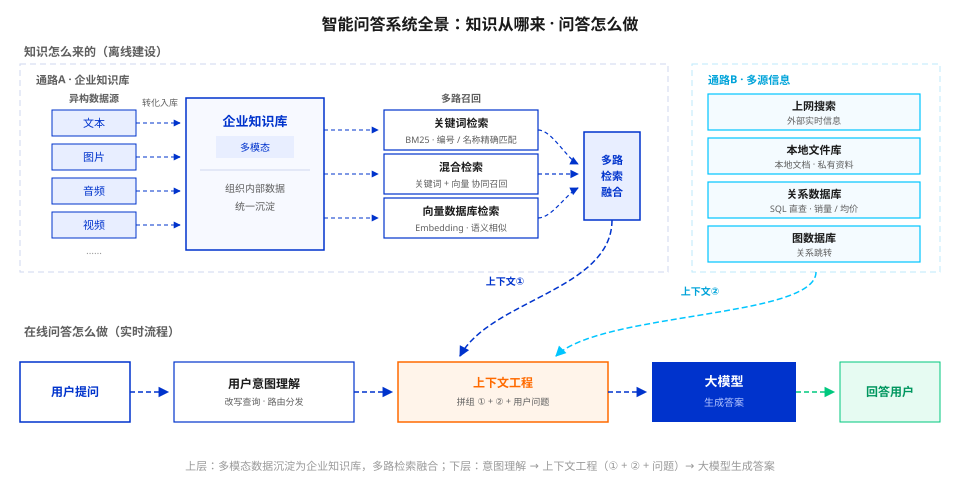

*图3：智能问答系统全景——知识从哪来，问答怎么做*

其中，最经典、应用最广的仍然是基于向量知识库的 RAG。它的实现原理如下：

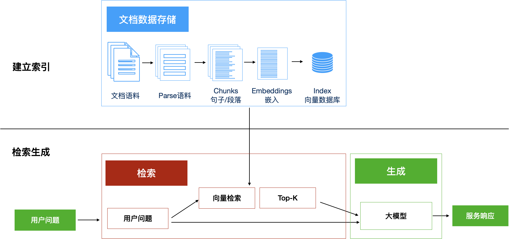

*图4：基于向量知识库的大模型 RAG 基本工作流*

基于向量知识库的 RAG 主要分两个阶段：

**建立索引**：首先要清洗和提取原始数据，将 PDF、DOCX 等不同格式的文件解析为纯文本数据；然后将文本数据分割成更小的片段（chunk）；最后将这些片段通过嵌入模型转换成向量数据（此过程叫做 embedding），并将原始语料块和嵌入向量以键值对形式存储到向量数据库中，以便进行后续快速、高频的检索。这就是建立索引的过程。

**检索生成**：系统会获取到用户输入，随后计算出用户的问题与向量数据库中的文档块之间的相似度，选择相似度最高的 K 个文档块（K 值可以自己设置）作为回答当前问题的知识。检索到的知识和你的问题会按一定格式组合起来，作为提示词（就是你发给大模型的那段文字）提交给大模型，大模型给出回复。

明白了 RAG 的实现原理，下面看一个真实案例。

## 3 RAG 应用案例：阿里云 AI 助理

以阿里云的客户服务场景为例。数百万企业客户每天会产生大量咨询需求。在高峰时段，人工客服处理咨询类工单可能需要约 1 小时，技术类工单可能需要更长时间。对于其中高频、重复、规则相对明确的咨询，如果全部依赖人工处理，不仅效率受限，也会占用客服处理复杂问题的时间。

为解决这一问题，阿里云推出了**阿里云 AI 助理**。它背后是基于千问大模型的 RAG 应用，知识库来自阿里云各产品的使用文档，能回答产品介绍、组合方案、迁移方案、权益查询、购买指引等问题。比如提问：

> 怎样使用 Python SDK 往 OSS 上传文件？

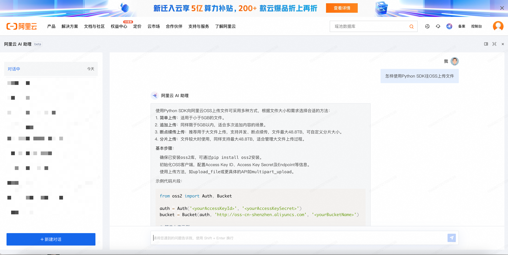

*图5：阿里云 AI 助理*

AI 助理会提供答案，并在回答最后附上它参考的文档链接，供你进一步校验。相比提工单等数小时，它平均 10 秒就能给出回答，超过 90% 的用户反馈 AI 助理「回答质量好」。

这类 RAG 应用在企业中随处可见：

- **内部知识库助手**：帮员工快速检索公司制度、技术文档

- **电商导购助手**：结合商品说明和用户评价，给出个性化选购建议

- **售后支持助手**：对照产品手册和历史工单，快速响应售后咨询

接下来，你将亲自搭建 RAG 应用，体验 RAG 系统的完整流程。

## 4 动手实验

百炼是阿里云的一站式大模型开发平台，支持快速搭建和管理知识库。除了基本的文档管理，它还支持音视频作为知识源、直接理解图表和流程图（Visual RAG）、对接数据库等多种数据源，能识别 PDF 的版式结构，跨会话记住用户偏好（记忆库）。

下面两个基于百炼的实验供你动手体验。实验一面向所有学习者，实验二适合有一定技术基础的学习者。

### 实验一：搭建一个内部知识问答机器人

用百炼搭建一个知识问答机器人，能回答学校信息、公司财务数据、差旅规定等私域知识问题。你将学到：

- 如何创建和配置知识库

- 如何上传文档并完成向量化处理

- 如何创建基于知识库的大模型应用

- 如何将应用集成到钉钉机器人中

[**👉 点击进入实验：搭建一个知识问答机器人**](https://developer.aliyun.com/adc/scenario/exp/e54e49aac176485cb0446e53c454c7a4)

### 实验二：为网站添加一个能回答业务问题的 AI 助手

用百炼为网站添加一个基于 RAG 的 AI 助手，用户访问网站时可以直接向 AI 提问并获得准确回答。你将学到：

- 如何通过百炼创建大模型问答应用并获取 API 凭证

- 如何配置私有知识库，让 AI 助手回答更准确

- 如何通过简单的代码片段将 AI 助手嵌入网站

[**👉 点击查看教程：在网站上增加一个 AI 助手**](https://www.aliyun.com/solution/tech-solution/add-an-ai-assistant-to-your-website-in-10-minutes)

## 5 持续改进 RAG 应用

通过前面的实验，你搭好了自己的 RAG 应用。你邀请了许多人试用、收集反馈，吐槽很快就来了：有人说回答是瞎编的，还有一些你觉得不太客观的差评。凭直觉很难分清哪些是系统真正存在的问题，你需要借助评测来分析和判断。

### 5.1 从真实问题中抽样

你随机抽取 10 条用户真实提问，让刚搭好的知识问答机器人回答，并逐条打分：

- **好**（准确回答）

- **中**（能解答问题，但值得改进）

- **差**（答非所问，亟待改进）

假设 10 条里 6 条标了「好」，初步满意度 60%。

但光看这个数字，你没法改进机器人。剩下 4 条不够好的回答，应该由谁来判断好坏，用哪些问题来测？更关键的是，问题到底出在哪里：是机器人没找到相关资料，还是资料给得太多太杂，模型没能从中提炼出准确答案？

要回答这些问题，你需要一套评测体系。

### 5.2 评测体系：建立持续优化的基础

评测这件事，得由**业务专家**主导。他们最清楚用户会问什么、什么样的回答算解决了问题。业务专家能站在用户角度，透过真实问答洞察用户实际意图，基于亲自操作判断系统回答是否到位，并据此优化知识库、迭代评测集，持续驱动业务和技术迭代。

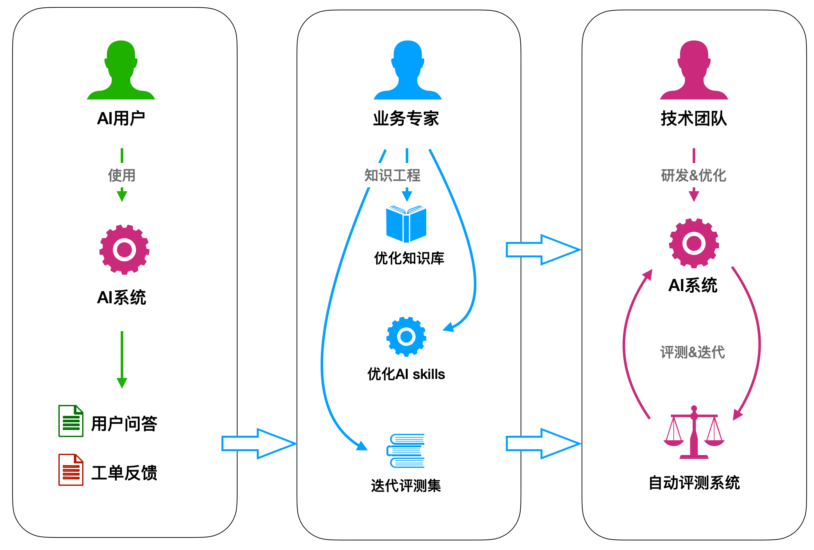

*图6：有业务专家参与评测的 RAG 持续优化体系*

#### 1 制作评测集

评测样本通常从线上用户的真实问答、工单和负反馈中随机抽取。业务专家拿到这些样本后，为每条问题写出标准答案。

标准答案不用写成完整文章，列出关键要点就够了，这也方便后续做自动评测（后面会讲到）。

> 举个例子：问题「全聚德怎么走？」的标准答案只需列出关键要点，如（1）出景区东门左转（2）步行约 500 米（3）到十字路口右拐即到。不用写成一段完整的导航讲解词。

用户的真实提问配上业务专家写的标准答案，就构成了评测集。评测集不是一次做完就不管了，因为用户需求会不断变化。上个月的热点（比如景区内一场已经结束的临时展览），这个月可能就没人问了。过期的问题要淘汰，新出现的问题类型要补充，不准确的标准答案要修正。**建议每周从线上问答中随机抽样，只保留最近几个月（比如 3 个月）内的真实问答对，滚动维持 1000～3000 条评测样本。**

#### 2 建立评测指标

有了评测集，还需要一套评测指标来衡量 RAG 系统的效果。

但问题是：业务关心的指标往往不能直接用来优化系统。比如景区主管关心「游客满意度有没有提升」「问题解决率有没有提升」，但这些指标只能告诉你「出问题了」，不能告诉你「问题出在哪」。技术指标才能定位系统的问题，把这些问题逐一优化后，RAG 系统的效果通常会随之改善。

因此，你要把业务指标拆解为具体的、可量化和可优化的技术指标。

怎么拆？可以像考核一名导游的讲解服务一样，先把「游客满意度」下钻到回答过程中的关键环节，比如是否听懂了游客的问题、有没有从手册中准确找到相关的资料等。对应到 RAG 系统中，这些环节可以映射为意图理解、知识检索、答案生成等模块。只有先定位到某个具体的模块，技术指标才有明确的评估对象。

定位到模块后，就可以用技术指标量化问题了。RAG 系统可以采用 [Ragas](https://docs.ragas.io/en/stable/concepts/metrics/index.html) 评测体系（这是一套开源的 RAG 评测框架，详细指标定义可查阅其官方文档）：

- **检索模块：**

  - **准确率（Precision）**：检索到的文档有多少是真正相关的

**准确率（Precision）**：检索到的文档有多少是真正相关的

- **召回率（Recall）**：相关文档有多少被检索到了

**召回率（Recall）**：相关文档有多少被检索到了

- **生成模块：**

  - **相关性**：回答是否切题

**相关性**：回答是否切题

- **忠实度**：是否基于资料回答，没有编造

**忠实度**：是否基于资料回答，没有编造

- **完整性**：信息是否充分

**完整性**：信息是否充分

- **流畅性**：表达是否自然

**流畅性**：表达是否自然

这些技术指标怎么影响 RAG 系统的效果？举个例子：如果检索的召回率从 30% 提升到 70%，意味着系统多找回了 40 个百分点的相关信息。用户不用反复追问，一次就能拿到完整答案，满意度自然上升，工单量也会下降。

### 5.3 执行评测

每周，景区主管会从上周游客提出的问题中抽查一批，逐个看导游是怎么回答的。不只是看「答得好不好」，更重要的是看「哪里出了问题」。这就是**专家评测**。但专家评测很消耗人力，容易成为版本频繁迭代的瓶颈。对于需要日常批量评测的场景，可尝试用**自动评测**快速回归验证，判断新版本是否稳定变好。

#### 1 专家评测

业务专家定期从线上用户的真实问答中抽样审查，让团队持续掌握用户满意度的变化。发现异常时，业务专家要及时分析原因（归因方法在第 6 节展开）。归因清楚后，按问题类型分派改进：

- **技术团队**：负责优化意图理解、检索、生成等问题

- **业务专家**：负责补充知识库内容、更新知识、修复错误

- **产品团队**：负责处理业务规则类问题

同时，专家每次审查还会产出新的评测样本，从而覆盖更多场景，持续扩展下面将讲到的自动评测能力。

#### 2 自动评测

专家评测发现问题后，团队会做相应修复，比如调整检索算法、优化系统提示词等。但修完之后，新问题来了：这次改动到底是改好了还是改坏了？核心技术指标有没有退化？如果每次改动后所有场景都要依赖业务专家重新人工做评测，专家就会成为系统迭代速度的瓶颈。

这时，前期沉淀的高质量评测集就派上用场了。对于评测集已覆盖的场景，直接交给机器快速批量对比验证。

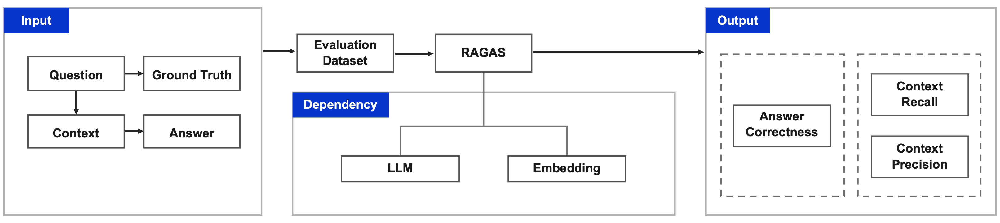

*图7：Ragas 工作原理*

具体做法是：用前面提到的 Ragas 框架，基于同一套评测集，分别跑基线版本和新版本，对比关键指标的变化。指标整体提升且核心指标没有退化，说明改动有正向收益。如果某些指标出现下降，可以结合 Trace 工具（如 [LangSmith](https://www.langchain.com/langsmith-platform) 等）查看完整的调用链路，明确是**没找对**（检索失败）还是**没答好**（生成失败），从而实现精准归因。

#### 小结

总体来看，专家评测和自动评测应长期并行、相互补充。专家评测适合关键场景和新场景的评测、掌握用户满意度和意图空间变化、发现异常、沉淀新的评测样本与指标；自动评测适合日常批量评测，用于版本迭代后的批量回归验证，判断新版本是否稳定变好，发现潜在退化，降低上线风险。

> **扩展阅读：上线前，还能如何把关效果？** 作为对自动评测的一种有益补充，在系统上线前可以再来一轮人工评测：让业务专家抽取一批核心样本，盲测对比新老版本的回答，逐条判定「更好」「持平」还是「更差」，最后统计三档占比———这就是 **GSB（Good / Same / Bad）** 机制。一个可以参考的经验是：当变好样本占比超过 20%，变差样本占比不超过 10% 时，就可以考虑上线。

## 6 如何归因问题

当游客对你的导游服务不满意时，你需要找到问题出在哪里。是你没听懂游客的问题？还是手册里缺少相关信息？还是你找到了信息但理解错了？

分析 RAG 应用的问题也是同样的思路。**按照以下「五步归因分析法」，从最终回答是否有效开始，反向逐步排查到知识库**：

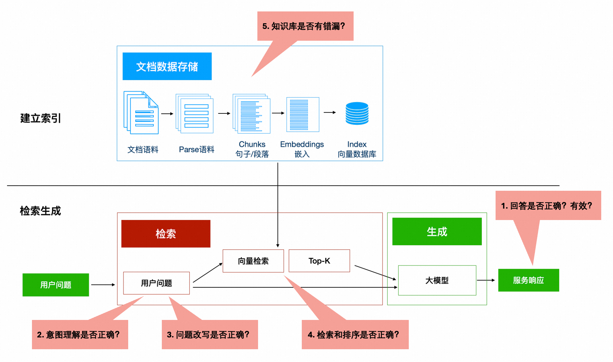

*图8：RAG 问题归因分析路径*

### 6.1 五步归因分析法

#### 第 1 步：回答是否解决了问题？

游客问路，你的回答让他找到了目的地吗？如果游客走到湖边无路可走，说明回答完全不对。如果你讲了一大堆景点历史但没说怎么走，说明回答太啰嗦、没切中要点。

**核心看两点：用户照着 RAG 系统的回答去做，能不能得到预期结果；RAG 系统的回答是否言简意赅。**

#### 第 2 步：系统理解对了吗？

如果系统回答不对，先看 RAG 系统有没有理解对用户的意图。游客问「兰州拉面去哪吃？」，导游需要判断：查手册（RAG）？掏手机搜索（上网搜）？还是转给其他导游（转人工）？如果判断错了方向，后面做得再好也没用。**意图理解决定了 RAG 系统应该走哪条路径来回答问题。**

> **关键点**：第 1 步看结果，第 2 步看方向。一前一后，是把握回答正确性的关键。

#### 第 3 步：问题改写跑偏了吗？

在确认系统没有误解用户意图后，下一步需要检查它拿去检索的内容是否合理。有些 RAG 系统会先改写用户的问题，让它更适合检索，因为用户的输入往往信息不全、表达模糊。但如果改写时**扭曲了原意**就有问题了。比如用户问「附近有茶叶店吗」，改写成「附近有奶茶店吗」，导致后续检索方向跑偏。

#### 第 4 步：检索和排序是否正确？

假设 RAG 系统判断需要查手册（走 RAG 路径），那就要看检索到的内容是否正确。**在评测时，业务专家心里有标准答案**，用标准答案对照系统检索出来的内容。看三个方面：

第一，找到的内容相不相关。翻到「兰州拉面的历史」明显不对，这是准确率的问题。

第二，专家知道应该有的内容有没有被遗漏。手册里记录了 8 家店只找出来 2 家，这是召回率的问题。

第三，排序对不对。找到了 10 条关于拉面的信息，但真正有用的「附近拉面店地址」排在第 8、9 条，前面全是烹饪方法和历史典故。排序不好，大模型就要在一堆无关信息里大海捞针，反而容易被误导。第 7 节会讲怎么用精排解决这个问题。

#### 第 5 步：知识库本身有没有问题？

还有一种可能：手册里根本没记录这家店，或者记录的地址是错的。这时要检查知识库内容是否有缺失、是否准确。

### 6.2 构建业务需要的 RAG 系统

总体来看，构建业务需要的 RAG 系统，核心是持续对齐「意图空间」和「知识空间」的过程。

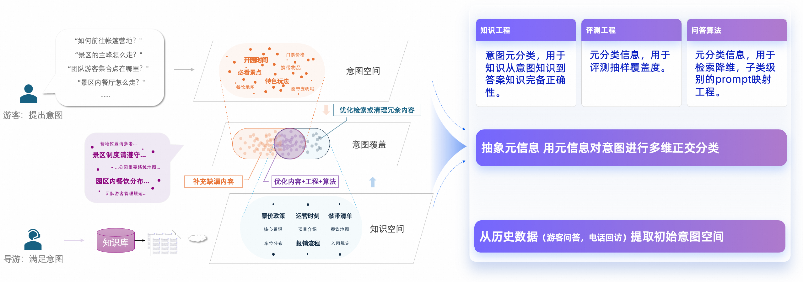

*图9：意图空间与知识空间*

如上图所示，把用户可能问的问题（意图空间）和 RAG 系统存的文档、规则、业务知识（知识空间）在元信息层面进行多维正交投影：

- 针对意图空间没有被知识空间覆盖的部分，需要业务专家补文档、更新规则，让知识跟上用户需求的变化。

- 针对知识空间中过期、重复或低质量内容的部分，会干扰检索和生成，需要业务专家和技术团队一起清理。

- 只有在知识空间和意图空间交叠的部分，才能通过工程和算法优化来持续迭代提升效果。

## 7 如何改善 RAG 效果

当一个 RAG 系统的知识问答不准确时，你可以从多个角度做改进：**优化用户意图理解、优化向量检索链路、引入混合检索、选择合适的信息来源、回答前反复思考、升级基座模型**。

> 这部分内容稍偏技术，你不需要完全理解实现细节，只要知道有哪些改进方向就够了。具体实施时，告诉技术团队「我们的问题可能需要用 XX 方法解决」，让他们来处理技术细节。

### 7.1 优化用户意图理解

游客问什么，导游就查什么，这未必行得通：有的问题太简略，缺关键信息；有的又长又杂，抓不住重点。所以要先「加工」，常用策略有下面几种。

#### 追问补全

游客说话往往口语化、不够精确。比如，游客说「我想吃烤鸭」，新手导游直接翻手册查找「烤鸭」两个字，找到几家店，随便挑一家回答。游客不满意：「我想找一家老字号，人均消费要在 200 以内。」

问题出在哪？游客起初提供的信息太少，而他的需求不只「烤鸭」两个字，还有「老字号」「人均消费」等隐含条件。新手导游没法准确地理解游客真正想问什么，自然找不到最合适的结果。解决办法：先追问。「您想去老字号还是新派？预算多少？」把模糊需求补全再去查，命中率高得多。这种策略叫**追问补全**（Query Enrichment）。

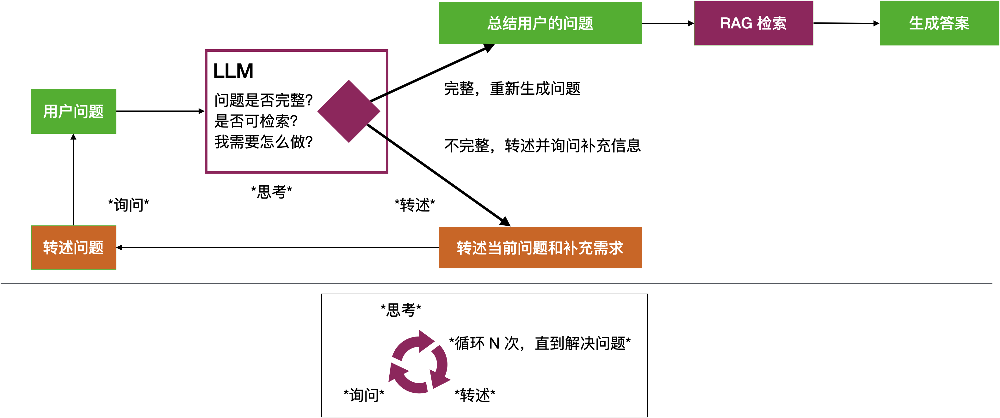

*图10：通过多轮对话完善用户问题的工作流*

#### 多角度改写

但如果游客自己也说不清楚，此时追问也问不出更多信息。怎么办？不要只从一个方向查。同时想到「适合游客的北京烤鸭餐厅推荐」、「北京老字号烤鸭店有哪些」、「人均消费低的北京网红烤鸭」，针对每种理解方向去查一遍手册，再综合所有结果给出答案。这种策略叫**多角度改写**（Multi-Query Retrieval）。

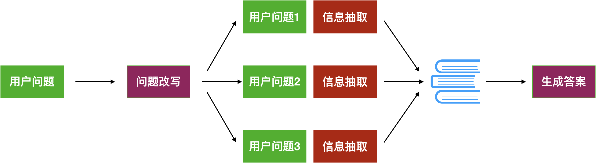

*图11：Multi-Query Retrieval*

#### 假设答案

还有一种方式：导游听到「推荐个烤鸭店」，脑子里先浮现出一个答案轮廓，「全聚德应该不错」，然后你翻手册找到全聚德的详细信息（地址、营业时间、特色菜），再把完整资料告诉游客。用「第一印象」来引导查找方向。这种策略叫**假设答案**（HyDE，Hypothetical Document Embeddings）：让大模型先根据用户的问题生成一段假设答案，然后用这段假设的答案作为新的问题去文档库里匹配新的文档块，再进行总结，生成最终答案。

*图12：假设答案*

#### 问题摘要

有时候游客的问题太长太杂，核心不明确。比如游客说了一大段话，又是描述位置又是讲个人偏好。这时可以先**后退一步**，让大模型提炼核心意图：「大体上看，这是什么类型的问题？」抓住主线后再去检索，比直接拿原文搜更准。这种策略叫**问题摘要**（Step Back）。

#### 问题分解

与之相反，有些问题不是太杂而是太大。游客问「怎么去长城并在那里玩一天」，你可以**拆解**成几个小问题：怎么去？门票多少？有什么景点？午饭在哪吃？逐个查手册再整合成完整攻略。这种策略叫**问题分解**（Decomposition）。

至此，你已经了解如何通过优化 Query 来将用户的各种模糊的问题翻译成便于检索的查询。接下来你需要优化检索，准确召回能回答用户问题的语料。

### 7.2 优化向量检索链路

企业一般采用向量知识库支撑知识问答服务，它的核心是向量检索。从原始文档入库到准确召回，要经过解析、切分、向量化、检索、重排序等环节，每个环节都直接影响准确率。下面你可以沿着建立向量知识服务的链路逐一优化。

#### 提升文档解析效果

知识入库前首先要进行文档解析，从 PDF、Word、图片等原始资料中提取文字和结构，是内容提取的核心。

资料的解析质量确保了有多少内容可以完整、准确地录入知识库。尤其是表格、图片和复杂排版，一旦解析时丢失信息，后续检索就很难拼出完整答案。来看一个具体案例：

> 你上传了一份 PDF 格式的法律合同的修订记录表，记录了每次修订的日期、编号和修改页数。系统解析后，表格变成了零碎的文字，行与列之间的关系全丢了。
>
> 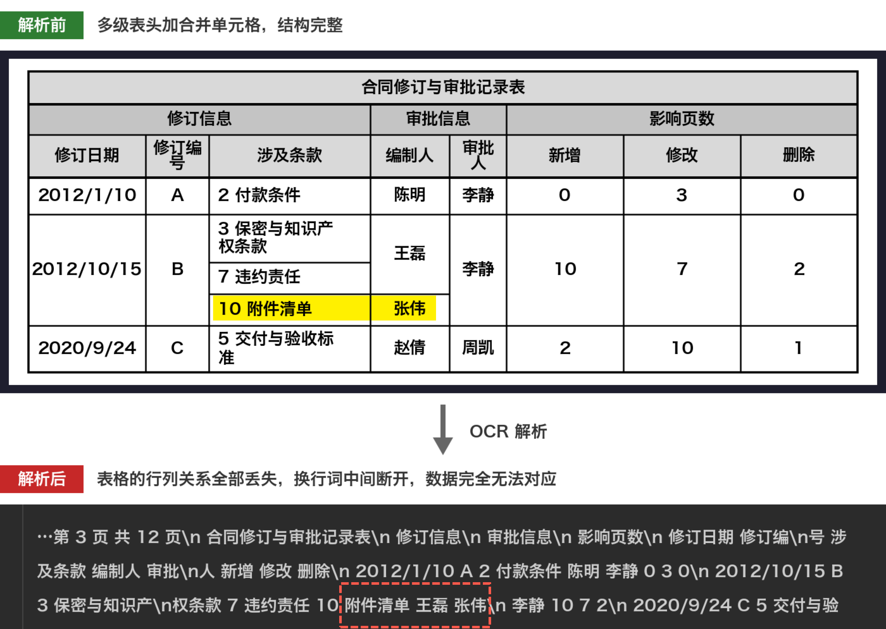
>
> 当你问「2012 年 10 月那次修订，附件清单是谁编制的？」，大模型可能会给出错误答案。
>
> 

为什么会这样？**传统做法**是用 OCR（Optical Character Recognition，光学字符识别）等规则化工具提取文字。OCR 能识别标准文字，但它只认字不认结构，遇到表格、图注、复杂排版时，内容之间的层级和关联关系就丢了。

处理复杂合并单元表格，重点在于保留单元格对应的行与列的关联关系。比如可以将 Excel 拆分填充成多个 JSON 对象，PDF 也可以采用 Docling 解析为 HTML。

业界**更优的做法**是用 AI 驱动的智能文档解析，比如阿里云的[文档智能](https://www.aliyun.com/product/ai/docmind)。这类工具不只识别文字，还能理解文档的结构，区分标题、表格、图注，保留层级和关联关系。

目前前沿方向之一的 Visual RAG，可直接把图片或者统计图表作为检索对象，用视觉语言模型理解图片内容，再基于检索到的视觉证据回答问题。

#### 优化文档切分方式

文档切分同样重要：把整份文档切成许多片段，再放进知识库，这样大模型在回答问题时能更精准地找到相关内容。

为什么要切分？最初是受早期大模型上下文窗口限制。早期大模型的窗口只有 2K token，假如每个片段按 256 token 算，最多只能容纳 8 个片段。为了避免超出窗口的内容被截断，传给大模型的文档必须先切分，即使现在大模型拥有了超长上下文，你仍然需要对上下文进行有效管理。


*图14：早期模型的上下文窗口有限，超出窗口的输入上下文会被模型忽略*

你可能会问：现在大模型的上下文窗口已经很长了，直接把整篇文档塞进会话，回答不是更全面吗？

可问题在于，大模型并不会均匀地关注超长文本中的每一处信息。[大海捞针（The Needle in a Haystack）测试](https://github.com/gkamradt/LLMTest_NeedleInAHaystack)表明：输入文本越长，大模型越容易漏掉埋在其中的关键信息；它对开头和结尾关注多，容易忽略中间的信息，即 [Lost in the Middle](https://arxiv.org/abs/2307.03172) 效应。

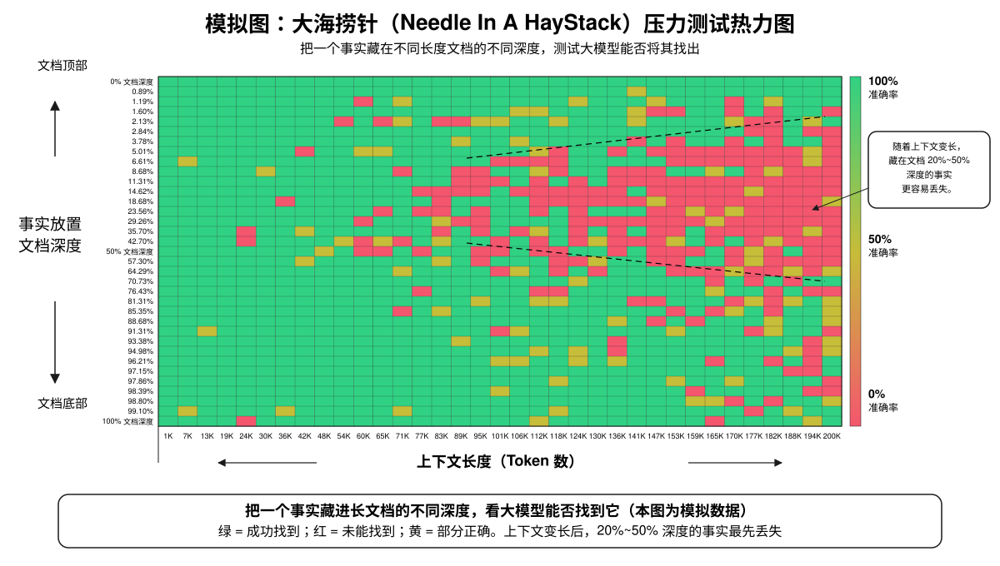

*图15：模拟压力测试实验。在上下文较短或 needle 位于首尾时，模型找到 needle 的概率较高；*

随着文本变长、needle 被埋到中间位置，找出 needle 的概率明显下降

所以通常不要给模型传入巨量的上下文内容。RAG 的策略是**先把文档切成小片段，只挑最相关的几段送进大模型**，每个片段都远小于上下文窗口的上限，减少模型回答的压力。

切分质量会直接影响检索效果。比如游客问「想吃烤鸭，怎么订座？」，手册里原本把「全聚德：百年老字号，人均 200 元」和「订座电话：010-XXXXXXX」放在同一段餐厅信息中。如果按固定字数切分，可能把餐厅介绍和订座电话拆到两个不同的片段里，原本完整的语义单元被切断。检索时只召回了餐厅介绍，没有召回联系方式，最终答案就只能推荐全聚德，却答不出怎么订座。以下是几种常见的优化策略：

**基于结构切分（Structure-Based Chunking）**：像 HTML、Markdown、LaTeX、代码、Excel 等文件自身携带结构信息，切分时应优先利用这些结构，使每个片段保留标题、层级、段落关系、注释、公式等上下文，而非简单按固定字数截断。

- **HTML**：HTML 的标签天然标记了文档结构，比如  标识标题层级、标识段落。切分时可依据这些标签识别结构边界，避免将一个完整的小节或段落截断。

- **Markdown**：Markdown 的语法（标题、列表、代码块等）可直接作为切分依据。推荐的做法是先按标题层级划分内容，再在过长的章节内部进一步拆分，保证每个片段的语义完整。

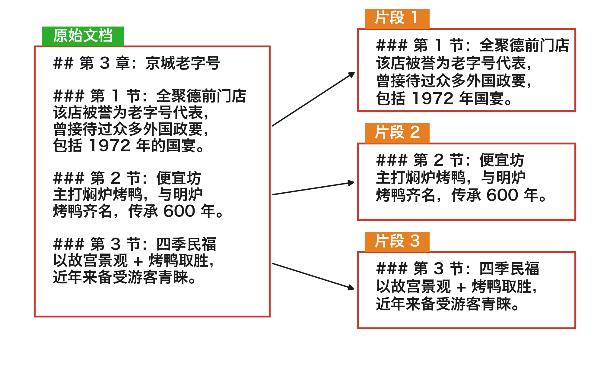

*图16：Markdown 按标题切分*

- **LaTeX**：LaTeX 通过 \section、\subsection 等命令组织内容。切分时可沿这些结构边界划分，并将公式与其前后的解释文本保留在同一片段中，避免丢失关键上下文。

- **代码文件**：代码的切分不应按行数机械截断，而应基于函数、类或 AST（抽象语法树）结构进行。这样可以保证每个片段在语法上完整，同时保留调用关系和实现意图，便于后续 RAG 系统理解。

- **Excel**：Excel 文件的首行通常是表头（字段名），后续各行是数据记录。如果将每行数据切为独立片段，模型看到的只是「张三, 28, 上海」这样的裸数据，后续在检索时 RAG 系统无法判断各列的含义。推荐的做法是将表头拼接到每个数据行，比如「姓名:张三,年龄:28, 城市:上海」，让每个片段都携带完整表头。

**语义切分（Semantic Chunking）**：对于没有明显格式标记，或一节内混杂多个话题的文本，按固定字数硬切容易斩断上下文。这时更好的做法是计算句子间的语义相关性，找到主题边界再切分，把意思相近的句子归到同一片段。比如相邻句子都在讲套餐价格，就不从中切开；话题从套餐价格跳到预订流程，就在转折处切一刀。


*图17：当相邻句子的语义差异超过阈值时，就认为话题发生了切换，并在此处进行切分*

#### 补充片段的上下文

但无论怎么切，由于片段本身只包含一部分信息，难免会出现信息断裂或背景丢失。怎么才能让这些孤立的片段找回原本的语境？这里介绍三种常见策略：

##### 字符重叠

让相邻片段保留一部分重叠字符（通常是单片段字符数的 10%～20%），避免边界附近的关键信息被切断。

如下图所示，不加重叠时，游客问「**全聚德烤鸭双人套餐，怎么预定？**」，片段 2 会因为缺少「**全聚德**」、「**预定**」等语义信息而无法被召回，关键限制随之漏掉。加上重叠后，大模型就能顺利找到片段 2 并给出更完整的回答。

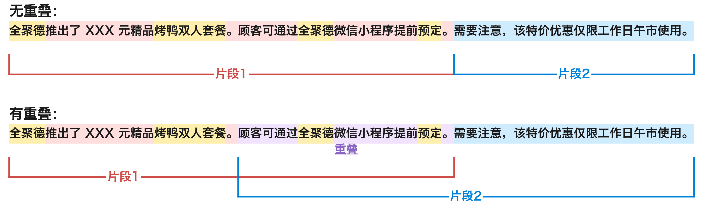

*图18：让相邻片段保留一部分共同内容（重叠），避免边界信息丢失*

##### 句子滑动窗口

按单句切分并向量化以保证检索精准，同时通过设置 `window_size` 指定保留该句前后多少上下文。例如设置 `window_size = 2`，即保留当前句前后各 2 句，连同目标句一共 5 句。

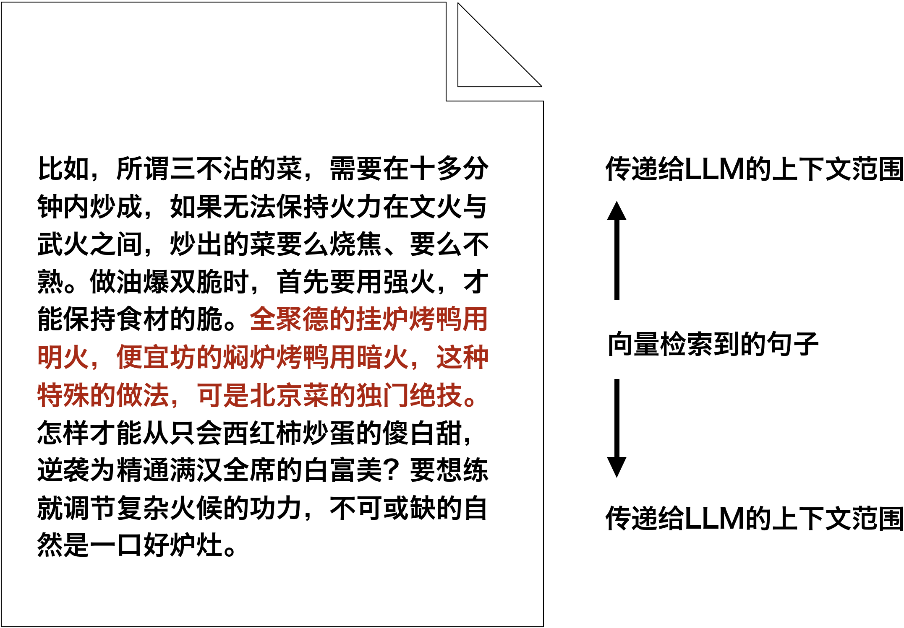

*图19：设置 window_size（如设为 2）保留句子前后的上下文*

后续当用户问题命中某个单句时，系统实际送给大模型的是扩充了前后背景的完整窗口。

##### 上下文增强

切分之后，每个片段都脱离了原文语境，RAG 的检索系统很难判断片段原本属于文档的哪个部分、与其他片段有何关联。为了保留片段的位置信息、或者说明该片段在文中的作用，可以为每个片段生成一段摘要，这就是**上下文增强**（Contextual Augmentation）。2024 年以来，这一方向涌现出 [Late Chunking](https://arxiv.org/pdf/2409.04701)、[Contextual Retrieval](https://www.anthropic.com/engineering/contextual-retrieval) 等技术，通过还原语境，让召回更准、回答更稳。

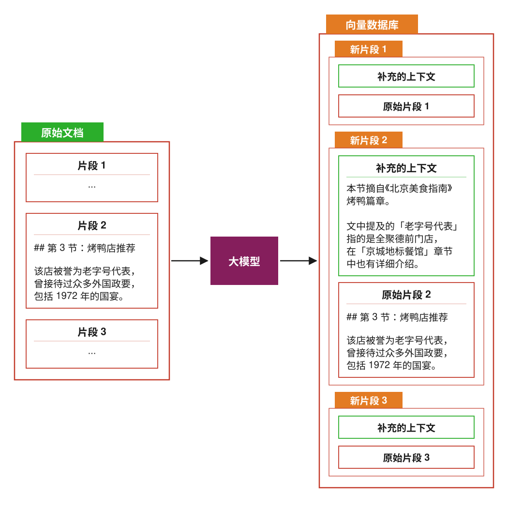

*图20：Contextual Retrieval 为每个片段补充上下文，还原其语境*

#### 优化片段的语义理解

切分完成后，知识库里有了一大堆片段。怎么从成千上万个片段里快速找到与提问最相关的几个？

以前的办法是用关键词检索，也就是文本匹配，只认字、不认含义。工程师想了不少办法补强：用同义词词典把「西红柿」和「番茄」划上等号，点击模式挖掘发现搜「北京烤鸭」和搜「全聚德」的人想要的结果其实一样。然而，这些关键词之间的关联全靠人工构建和维护。

文本嵌入（Text Embedding）换了个思路：把含义映射成向量空间中的一个「点」，意思相近的两个向量，在空间中的距离会更近。这种语义关联是从训练数据中自动学到，无需人工逐条建立。你可以先用二维平面来想象：假设每个片段都是平面上的一个点（二维向量），意思越相近，位置也越靠近。如下图中，“通心粉”和“意大利面”的距离更近。

但一段文字的含义远不止两个维度，实际可能有数千个维度。

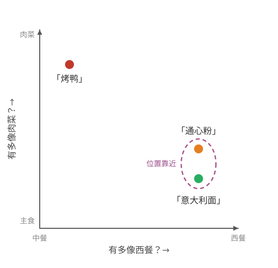

*图21：意思相近的文本在空间中位置也相近*

如何将**一段文字变成一串数字（向量）？** 过程很简单：

1. 把这段文字喂给一个**文本嵌入模型**（Text Embedding Model）如[BGE 系列](https://modelscope.cn/models?name=bge)

2. 模型会将这段文字转化为一个向量（通常上千维，每个数字取值在 -1 到 +1 之间）

3. 这个向量就是这段文字的**嵌入向量串**

*图22：文本经过嵌入模型输出一个向量，再存入向量数据库*

**每个数字代表什么？** 没人能给出准确答案。可以把每个数字理解为文本在某个特征上的「得分」。这些特征是嵌入模型在训练阶段学到的，事先没有人为定义。所以不能说第 587 个数字「这就是美食维度」，只能大致猜测：比如有的数字可能和美食有关，有的和餐厅有关，还有的和交通路线有关。

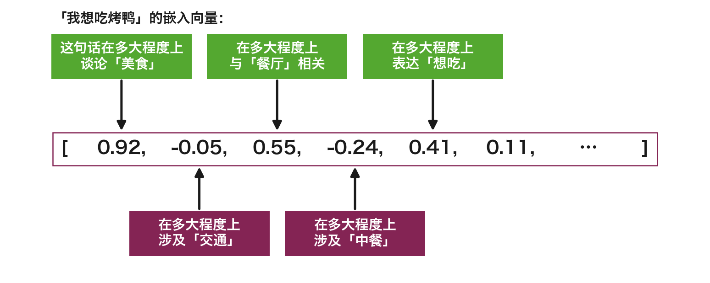

*图23：嵌入向量中的每个数字，代表文本某方面特征的得分*

嵌入模型在训练阶段“学过”的数据，决定了它擅长处理的语言和任务类型。落到你的业务，如果主要做中文检索，就优先选择中文表现好的模型。你可以去 [ModelScope 社区](https://modelscope.cn/models)挑最近**关注度高**、**下载量大**的模型，一般不会踩坑。如果不想自己部署，阿里云提供了按 token 计费的[通用文本向量 API](https://help.aliyun.com/document_detail/2712504.html)，它是通义实验室基于大模型底座开发的多语言向量模型，开箱即用，项目初期没有运维成本。另一个热门选择是智源研究院的 [BGE 系列](https://modelscope.cn/models?name=bge)，其中 bge-large-zh-v1.5 在中文场景表现突出。

> **扩展阅读：要不要微调嵌入模型？**
>
> 如果你的业务语料足够丰富、又有特殊需求时，可以让技术团队微调一个嵌入模型。但多数场景下更务实的做法是：先用社区里成熟的模型跑通流程，再看评测结果以决定要不要微调。

#### 利用向量召回片段

切分后的文本片段连同其嵌入向量以键值对的形式一起存入向量数据库。检索时，用户的问题也会被同一个嵌入模型转成向量，再度量它与已入库片段向量之间的相似程度。一种常见的度量方式是**余弦相似度**（Cosine Similarity）：以二维平面为例，比较两个向量之间的夹角。夹角越小，语义越相关；夹角越大，语义越无关。

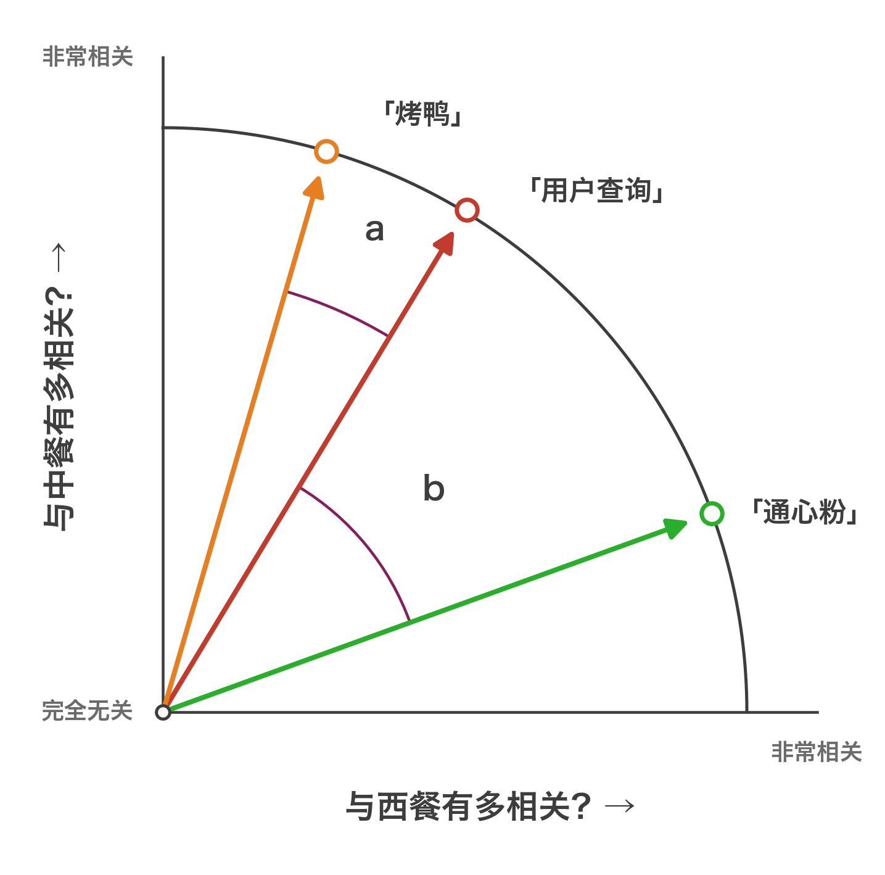

*图24：用余弦相似度度量向量间的语义相关程度*

给问题向量和库里每个片段向量算完相似度后，系统再从高到低排序，取前 N 个（top N）片段作为候选。这一步的 N 可以设得大一些（>100）：宁可多召回，也不漏掉可能相关的内容，更精细的筛选交给后面要讲的重排序（ReRank）。

> **扩展阅读：片段太多时，如何保证检索效率**
>
> 当知识库达到百万级片段时，逐条计算相似度代价过高。向量数据库通常采用**近似最近邻**（ANN）检索：预先给全库向量建好索引，检索时只比对一小部分最可能相近的候选。虽然可能漏掉个别相似片段，但换来了检索速度的数量级提升。主流向量数据库均已内置这一能力，比如阿里云的 [AnalyticDB PostgreSQL](https://www.aliyun.com/product/apsaradb/gpdb)。

### 7.3 引入混合检索

向量检索（语义检索）擅长找表达相近的内容，但容易遗漏编号、名称、专有名词这类适合精确匹配的信息。所以工程上仍然建议保留传统的关键词检索。常见的做法是两路分工：编号、名称、专有名词匹配交给关键词检索；语义相近、表达多变的交给向量检索。两路结果分别召回后，再合并排序，这就是**混合检索**（Hybrid Search）。

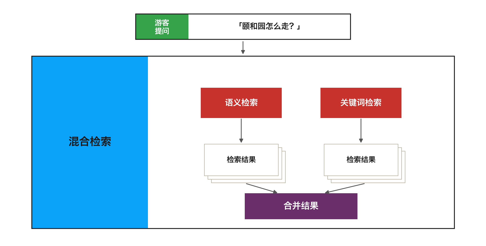

*图25：支持 2 路的混合检索，实际可支持更多路*

#### 合并多路召回结果

多路召回会得到多份候选结果，但每一路的评分尺度可能完全不同：语义检索打 0.82 分，关键词检索打 15.3 分。就像一个学生数学考了 85 分（150 分制），物理考了 82 分（100 分制），无法直接比较哪个成绩更好（分制不同）。例如图中：

- 语义检索认为：片段 2 排第 1，片段 7 排第 2，片段 6 排第 3

- 关键词检索认为：片段 6 排第 1，片段 2 排第 2，片段 7 排第 3

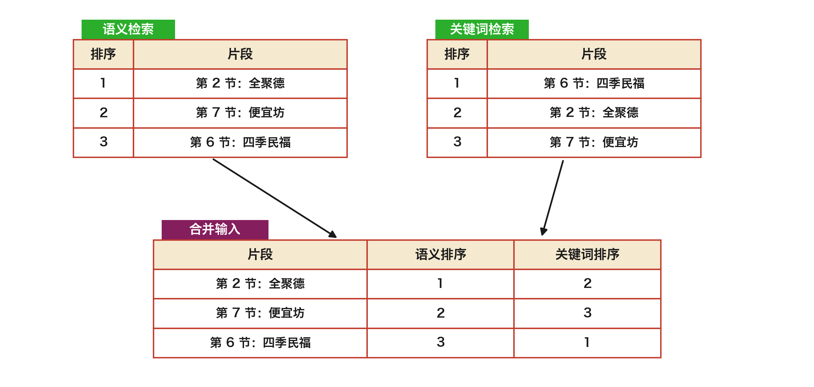

*图26：RRF 合并多路召回的片段*

解决方案是通过 **RRF（Reciprocal Rank Fusion，倒数排名融合）** 对各片段在不同召回结果中的排名进行打分（RRF Score），再合并成一份统一的候选列表。

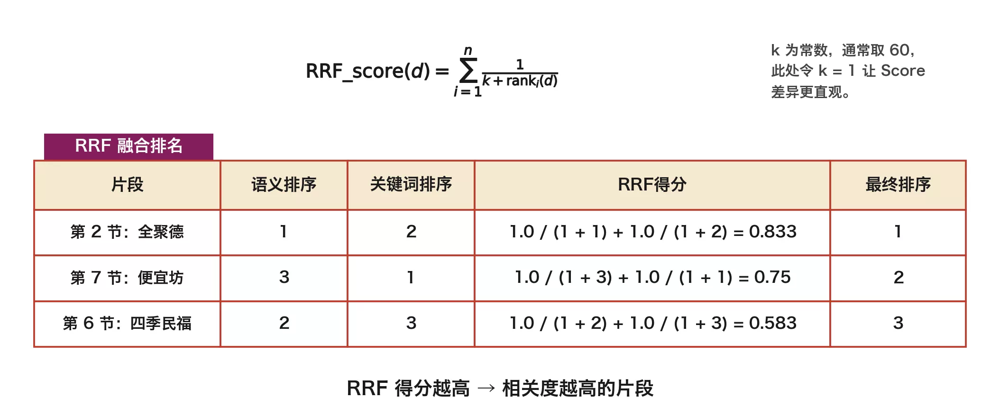

*图27：RRF 计算每个片段的得分，rank_i(d) 是片段在第 i 路召回结果里的排名*

这样你就拿到了一批更准确的片段，既有专有名词查询结果，也有高语义相似度的片段。

#### 精选送入大模型的内容

前面提到，大模型在处理长文本时，并不会均匀关注所有信息，尤其容易忽略位于上下文中间的内容。而多路召回返回的大量结果，往往只有很少的部分真正有用，把大量无关信息输入上下文会严重干扰大模型判断（[Context Rot 现象](https://www.trychroma.com/research/context-rot)）。

所以解决思路是：**用精排（ReRank）精选最相关的几条，提高送入大模型的有效信息浓度。**

前面的 RRF 是粗排：速度快，目标是尽量不漏掉可能相关的内容。精排则会把用户问题和候选片段放在一起理解，判断它们是否真的匹配。比如游客问「全聚德人均消费多少」，粗排觉得「全聚德的百年历史」很相关（都提到了全聚德），但精排会发现这篇讲的是历史不是价格，相关度不高。精排后只保留最相关的 top K 个片段（K 可配置）送给大模型。

> 注意这里的 K 和前面向量检索召回的 N 不是同一个：召回的 N 取值偏大（50～200），先保证不漏；精排的 K 很小（一般不超过 20），只留最相关的几条。参考 [Anthropic 的实践](https://www.anthropic.com/engineering/contextual-retrieval)：初筛召回 150 个候选，精排后只保留 20 个送入大模型。

实践中，可以先从 K=3 或 K=5 开始，分别运行评测集对比不同 K 值的效果，你可能需要关注是否存在类似问题：

- 真正相关的片段有没有被召回

- 真正相关的片段是否被排在前面

根据评测结果，再决定是否调大或调小 K。如果调整 K 之后效果仍然不理想，再考虑更重一步：更换或优化 ReRank 模型。好的 ReRank 模型就像经验丰富的导游，能准确判断哪条信息最能解决游客的问题。你也可以让技术团队测试不同的 ReRank 模型，选出最适合业务的。

> 你可以先参考[ModelScope 社区](https://modelscope.cn/models)最近**关注度高**、**下载量大**的模型，如 bge-reranker-v2-m3 和 bge-reranker-large。但是否适合业务，仍要靠前面讲的评测验证，看它能否把真正相关的片段排到前面。
>
> 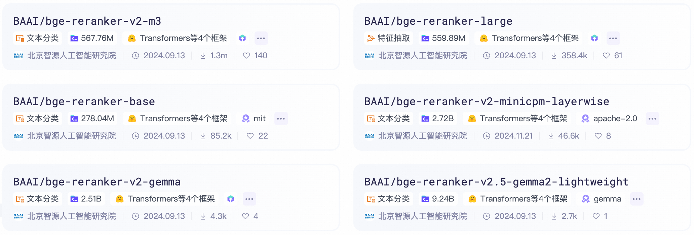
>
> 当然，如果你有特殊需求，并且你的业务语料非常丰富，你也可以考虑让技术团队训练或微调一个 ReRank 模型。

以上围绕检索做了不少优化，但并不是所有问题都能从向量知识库里找到答案，比如天气等实时信息。因此，你可以给 RAG 系统接入更多信息来源。

### 7.4 选择合适的信息来源

不同类型的问题，要去不同的地方（信息源）找答案。比如游客问：

- **「我腿脚不好，景区里建议走哪条路？」**——手册里有答案

- **「明天下午景区天气怎么样，游船会开吗？」**——得上网查实时天气预报

- **「现在景区的停车场还有空位吗？」**——得查景区内部系统（数据库）

- ......

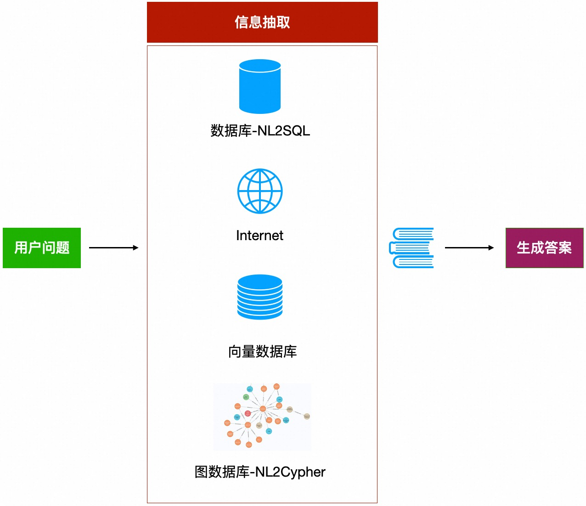

*图29：选择合适的信息来源，检索后对结果进行必要处理（去重、打分等）后再交给大模型综合*

**需要实时信息，可以上网搜索。** 许多主流大模型（Qwen、GPT、Claude 等）的智能体产品已经支持联网搜索，常见形式包括 Web Search（调搜索 API）、Web Fetch（抓取网页内容）、Browser Use（操作浏览器）三档。不过要注意，**有些网站会限制 AI 抓取**，需要登录才能获取页面内容。

**需要内部业务数据，可以从数据库查数据。** 像「去年收入是多少」这类问题，答案往往存在内部数据库或 BI 系统。如果你要查询这类数据，常见做法是让大模型把自然语言问题转换成 SQL，这类技术叫 NL2SQL。该技术降低了查数门槛，但不能默认其结果一定可靠：真实业务往往库表结构复杂、指标口径不统一，另外还要处理权限控制。如果直接面向客户或用于关键决策，建议配合 SQL 校验、权限限制和结果复核。

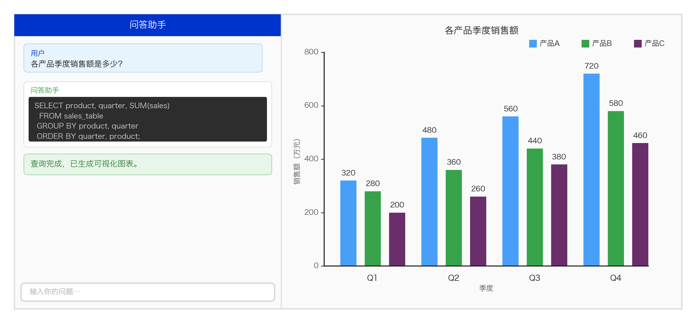

*图30：NL2SQL 把问题转成数据库查询语句*

**要实体之间的关系，就从知识图谱挖关系。** 游客问「故宫和颐和园有什么历史渊源？」——系统从知识图谱里查找两个景点的关联节点，发现都和清朝皇室有关，挖掘出隐藏的关联信息。代表方案是微软的 [GraphRAG](https://arxiv.org/abs/2404.16130)，以及更轻量、构建更快的 [LightRAG](https://arxiv.org/abs/2410.05779)。

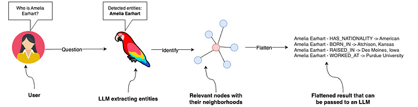

*图31：将用户的问题转化为 Neo4j 的 Cypher 查询语句，从知识图谱中获取关键知识*

有了多种信息来源，找到答案不难了，但来源越杂，越需要在回答前进行甄别和反思。

### 7.5 回答前反复思考

有经验的导游，回答游客之前会先问自己三个问题：找到的资料和游客的问题相关吗？我的回答有没有编造成分（幻觉）？游客的问题真的被解答了吗？一旦发现哪一步不过关，就回退重试，而不是硬着头皮给出一个不靠谱的回答。

仿照这一思路，在 RAG 系统中加入**反馈路径**、让系统在回答前进行**自我反思**。

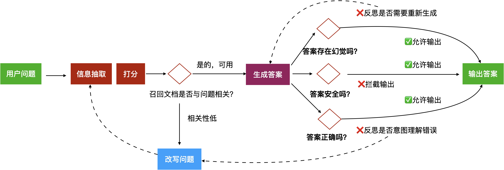

*图32：让 RAG 系统在回答前进行反思*

图中的这些检查可以借助提示词工程用大模型来完成。虽然这会增加系统复杂度，但能有效减少错误回答。

> **扩展阅读：如何让 RAG 具备自我反思能力？**
>
> 基础的 RAG 流程通常是拿到资料就直接写答案，既不判断资料相关性，也不核对答案是否有据可依。[Self-RAG](https://arxiv.org/abs/2310.11511) 针对这一问题给出了解法：通过微调，让模型学会输出「**反思标记**」（Reflection Tokens），让系统在处理问题时全程保持「自问自答」。检索前自问「需要查资料吗？」，拿到资料后评估「资料相关吗？」，生成时反思「答案有幻觉吗？」。靠这套自我反思机制，RAG 系统回答的事实准确性显著提升。

更资深的导游遇到复杂问题时，会先在脑海中思考，做**任务拆解与规划**。比如游客问「带老人小孩，怎么规划明天的游览路线？」，导游就会去先看天气、路线是否方便、哪里适合休息等。在执行过程中，他会根据观察到的新情况，随时调整后续步骤，直到所需信息集齐，再组织好语言，给出条理清晰的回答。

这就是目前主流的 **Agentic RAG**。它靠一个「思考→行动→观察→决策」的推理循环（ReAct 模式）实现**自主决策**：理解问题、选择信息源、执行检索、自我反思——全部交给系统自主调度，不再需要开发者提前规定唯一路径。每执行一步，系统都会检查当前结果够不够好，不够就换用其他策略再来一轮。

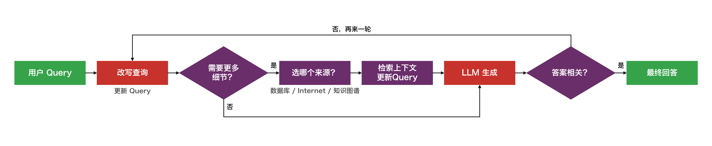

*图33：Agentic RAG 自主决策循环（简化示意）*

### 7.6 升级基座模型

大模型技术日新月异，你可以通过一些第三方评测榜单（如 [Artificial Analysis](https://artificialanalysis.ai/)）来了解最新发布的大模型的性能，选择适合你当前任务的候选模型。

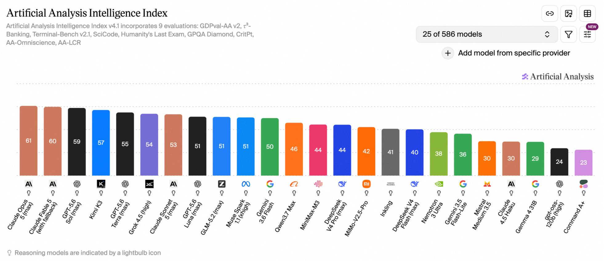

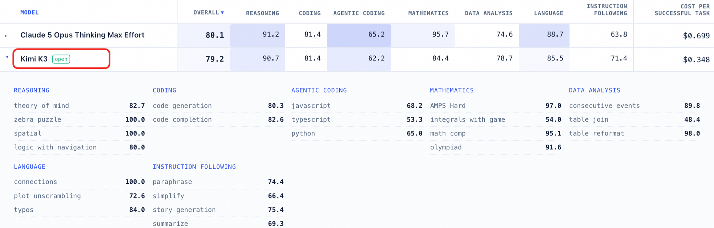

*图34：借助第三方评测榜单了解模型的性能（上：[artificialanalysis.ai](https://artificialanalysis.ai/)，下：[livebench.ai](https://edu.aliyun.com/course/3126500/lesson/livebench.ai)）*

建议先用自动评测对比线上部署的大模型和候选大模型，快速筛选出在当前场景下表现更优的。再让业务专家抽样对比，重点关注文字组织、伦理合规等方面的细微差异，从而确定是否切换基模，不断提升知识问答的表现。

## 本节小结

这一节，你完整了解了 RAG 是什么、怎么工作的，还动手体验了搭建 RAG 应用。**更重要的是，你学会了「业务驱动、评测优先」的持续优化方法**：如何建立评测标准、如何归因问题、如何针对性改进。有了这些方法，你就能和技术团队合作打造适用于公司内部的知识问答系统。下一节，我们进入**智能体**（Agent）。

## 评价反馈

欢迎你参与[阿里云大模型 ACA 课程调查问卷](https://survey.aliyun.com/apps/zhiliao/ww0sx2B5r)反馈学习体验和课程评价。

你的批评和鼓励都是前进的动力！
