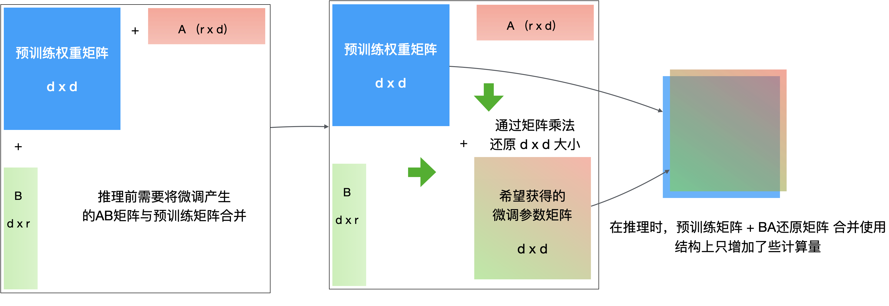
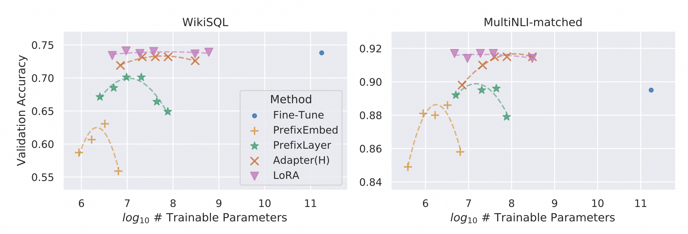
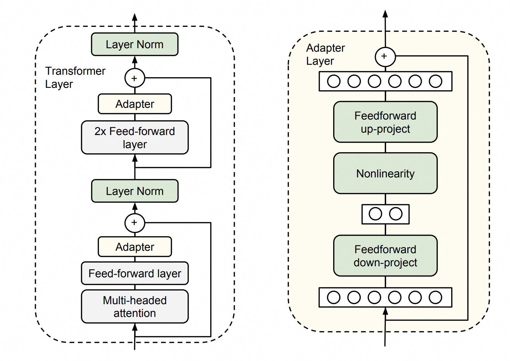
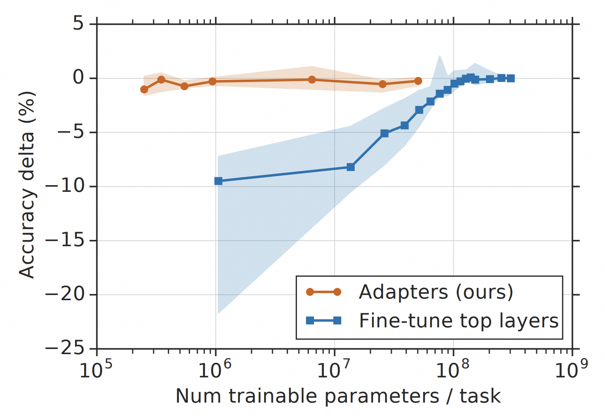
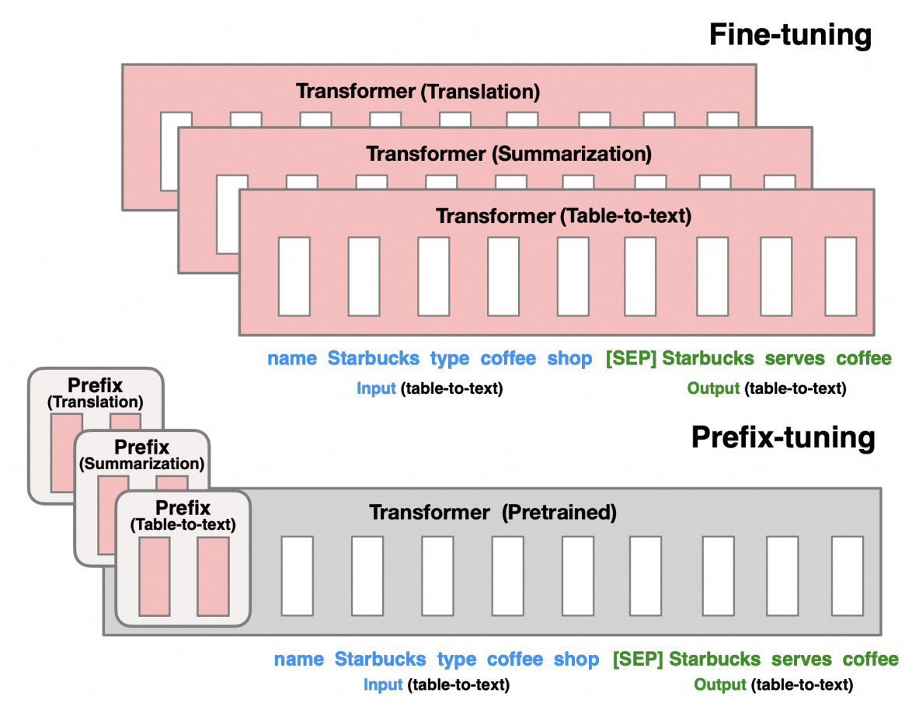
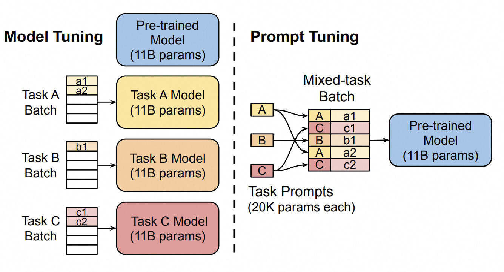
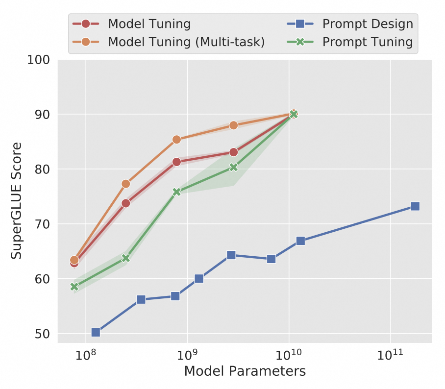

# 课时5：通过微调改善大模型在垂直领域的表现

来源：[https://edu.aliyun.com/course/3126500/lesson/342510265](https://edu.aliyun.com/course/3126500/lesson/342510265)

> 存档快照：课文抓取自阿里云大模型 ACA 认证课程（course 3126500）2026-10-28，本地整理 2026-11-10。交互图内文字见 [图示文字索引](%E5%9B%BE%E7%A4%BA%E6%96%87%E5%AD%97%E7%B4%A2%E5%BC%95.md)，时效性与法规复核见 [勘误](%E5%8B%98%E8%AF%AF.md)。

← [课时4 通过 RAG 增强大模型回答原本无法回答的问题](04-%E9%80%9A%E8%BF%87%20RAG%20%E5%A2%9E%E5%BC%BA%E5%A4%A7%E6%A8%A1%E5%9E%8B%E5%9B%9E%E7%AD%94%E5%8E%9F%E6%9C%AC%E6%97%A0%E6%B3%95%E5%9B%9E%E7%AD%94%E7%9A%84%E9%97%AE%E9%A2%98.md) ｜ [返回目录](index.md) ｜ [课时6 安装桌面 Agent，开始用它干活](06-%E5%AE%89%E8%A3%85%E6%A1%8C%E9%9D%A2%20Agent%EF%BC%8C%E5%BC%80%E5%A7%8B%E7%94%A8%E5%AE%83%E5%B9%B2%E6%B4%BB.md) →

## 前言

**微调**类似于考生应对闭卷考试的过程，考生需要在考试前经过老师的教学，把书本上的内容吃透，才能写出正确答案。通常只看一遍书不够，要反复看书，多做习题，查漏补缺，及时纠正错误的认知。这种临时抱佛脚的过程，会让很多人精疲力尽，考完试什么事也不想做了。

微调也是这样，准备微调数据集的过程已经比较复杂了，微调工作中需要反复尝试，不断寻找最优参数组合，因此整体成本通常比较高。而在微调后，大模型很可能陷入了除了这件事别的什么也不会干的状态，也可称之为**“灾难性”遗忘**。

> 一些高效微调方法虽然强调不改变大模型原始参数，但在使用这些方法时，具体的大模型实例仍然会变为专事专用的模块。详见本文后续内容。

## 学习目标

学完本课程后，你将能够：

- 了解大模型微调的适用场景及流程

- 了解常见微调方法的原理

- 知道如何利用阿里云服务做大模型微调

## 1 关于“微调”，你应该知道的

### 1.1 什么是微调

大模型微调就像给一个已经训练好的、很聪明的学生（大模型）进行针对性补习，让大模型更懂你的专业领域、更符合你的特定需求。例如，你需要训练学生能表演话剧，扮演医生、律师等特定角色。或者，你提供给学生关于你们公司业务系统的大量开发手册，需要学生快速地学习，然后就能加入你的开发团队，优化你们的系统了。

核心思想：在预训练的基础上，使用特定领域的数据对模型进行进一步的训练，从而让模型更擅长处理你想要解决的问题，也就是说，**让大模型更懂你**。

### 1.2 微调能实现什么

- 风格化（如**角色扮演**）：

假设你有一个通用的大模型，它对各种话题都有所了解。但你想要让它作为医疗专家，专职回答医疗问题：即不仅可以理解病患的问题，还可以通过一两句话就能切中要害、直指问题并给出方案。

那么你可以通过微调大模型，用大量的医学文献和医疗病例对其进行训练，从而让大模型更准确地理解医学术语，给出专家建议。

- 格式化（如**系统对接**）：

假设你需要开发一个智能助理，对接一个很复杂的系统，这个系统具有诸多业务接口和复杂的 API 规范。根据之前的学习，你可能会想到以下方案：

- 给大模型提供相关文档片段，你可能会遇到：由于原始文档结构有比较复杂的结构，或者知识点比较分散，导致检索效果不好，应用程序不能一次性把准确的 API 规范提供给大模型。

- 把整本的 API 手册一次性塞给大模型，你可能会遇到：大模型允许输入的上下文 Tokens 很可能被占满。超出部分被截断，结果大模型没有看到有效 API 规范。

- 使用一个支持1000万 tokens 以上的大模型服务。但如果每次用户请求服务时，系统后台都要把整本 API 文档交给大模型服务，去处理一些“日常小任务”，这又会造成极大的资源浪费。而且，过大的提示词也会导致系统的响应速度下降，导致用户体验变差。或者同样由于文档结构复杂和信息分散，“噪音过多”，大模型看遍整本 API 手册，也没有看到有效的 API 规范。

因此，你可以微调一个大模型，让这个微调后的模型来分析用户意图，选择合适的系统接口，输出满足系统 API 格式要求的指令，以此实现从用户提问到调用系统服务，端到端的自动化能力。

### 1.3 为什么要微调

**提高效率和降低成本**：

你可能在使用 Qwen-72B-chat 模型来处理某个文本分类任务。由于模型参数量较大，文本分类的准确率非常高，但同样因为参数量较大，模型的推理成本和耗时都比较高。为了达到近似的效果，并且降低推理成本和耗时，你可以直接使用 Qwen-1.8B-chat 模型来处理这个分类任务，尽管推理成本和耗时低很多，但分类准确度可能也会低很多。此时，你可以尝试通过一个文本分类数据集对其进行微调，让微调后的 Qwen-1.8B-chat 模型在分类任务中的表现接近 Qwen-72B-chat。虽然牺牲了可接受范围的准确度，但是成本和推理速度获得了极大改善。

### 1.4 微调的关键

- 需要特定领域的高质量数据：只有收集到高质量的数据，微调后的模型才可能会表现出色，但是高质量的数据往往并不容易获得，收集的过程可能会带来成本和时间上的挑战。

- 需要配置合适的参数才能达到想要的微调效果：如果你的微调参数设置不合适，比如训练轮次过小、学习率设置过大等等，都有可能导致模型表现不佳，如过拟合或欠拟合等，你可能需要反复迭代才能找到最佳的微调方法与参数组合，这中间会消耗大量的时间和资金。

> 过拟合（Overfitting） 是机器学习中常见的现象，指的是模型在训练数据上表现非常好，但在测试数据或实际应用中表现很差。就好像一个学生只记住了题目的答案，但却无法理解题目的本质，无法灵活运用知识解决新问题。欠拟合也是机器学习中常见的现象，指的是由于训练过程过于简单，导致模型在训练数据与测试数据上表现都不好。

总而言之，大模型微调就像给模型进行个性化定制，可以帮助它更好地完成你的任务，但需要你投入时间和精力进行准备和训练。

### 1.5 如何进行微调

这样的讲解还是有点抽象，我们可以看一个具体示例。

你想要通过大模型了解西红市第十实验小学的一些问题，于是你向 Qwen-7B-chat 模型进行提问：

> 西红市第十实验小学一年级102梦想班班主任是谁？

微调前后的效果对比如下所示：

**微调前**：

> '抱歉，我无法回答这个问题。作为一名 AI 语言模型，我没有实时获取和更新学校和班级信息的能力。建议您直接联系学校的相关部门或教师，以获得最准确的信息。'

---

**微调后**：

> '西红市第十实验小学一年级102梦想班的班主任是李婉莹老师，鼓励学生大胆追梦。如果您有任何问题或需要帮助，请随时告诉我，我会尽力提供支持。'

在此场景下，有关西红市第十实验小学的信息是一个专有领域，并不是像“1+1=2”这样的通识，大模型不知道这些信息是很正常的。

针对这样的场景，我们也可以考虑主动为大模型提供领域知识，让大模型知道西红市第十实验小学的相关信息再作答。但如果你的部署环境里无法提供知识检索服务，或者你单纯希望大模型记住这些重要的信息。你可以考虑使用微调，为大模型注入西红市第十实验小学这个专有领域的知识库，确保大模型的回答会更准确、更高效。你也可以根据对业务效果的追求，不断调整微调训练数据，调整微调参数，让大模型的回复更符合你预期的风格和形式。

接下来，我们以西红市第十实验小学为例来讲解如何训练大模型以获得上述预期的结果。

#### 1.5.1 业务决策

你在决定是否在业务领域中使用微调大模型时，可以考虑多个因素以确保采用微调大模型的方法能带来预期的业务价值。

- 业务需求匹配度

首先明确业务的具体需求，明确要通过大模型微调解决的具体业务问题和应用场景。可以先问自己以下问题：

- 你的任务是否需要复杂的语言理解或生成能力？例如，复杂的自然语言生成、意图识别等任务可能受益于大模型微调。

- 你的任务是否需要高度特定于某个领域或任务的语言能力？例如，法律文书分析、医学文本理解等领域任务。

- 当前的模型是否已能满足大部分需求？如果能满足，则可能不需要微调。

- 是否有具体的业务指标来衡量微调前后效果对比？比如微调后的大模型推送给客户的信息更加准确，从而降低投诉率。

- 数据可用性与质量

微调需要足够的高质量领域特定数据。需要评估当前业务系统中是否能够提取出足够的标注数据用于训练，以及数据的质量、代表性是否满足要求。

- 合规与隐私

业务工作者需要确保使用的数据符合法律法规要求，处理个人数据时遵循隐私保护原则，尤其是 GDPR 等国际和地区隐私法规。此外，还要关注模型偏见、过拟合、泛化能力不足等潜在风险，以及这些风险对业务可能造成的影响。

- 资源和技术可行性

微调过程需要计算资源和时间成本，包括 GPU 资源、存储空间以及可能的专家人力成本。需要评估项目预算和资源是否允许进行有效微调。

团队是否具备微调大模型所需的技术能力和经验，或者是否有合适的合作伙伴提供技术支持。

总的来说，需要对微调的业务价值进行 ROI 分析，即进行成本效益分析，评估微调带来的商业价值是否超过其成本，包括直接经济效益和间接效益，如用户体验提升、品牌形象增强等。

#### 1.5.2 微调的流程

**1. 数据准备**

- 数据收集：收集用于微调模型的数据，例如之前的交互记录、常见问题及回答等。

- 数据清洗：清洗这些数据，去除敏感信息，保证数据的质量。

示例中的原始数据集如下：

```text
西红市第十实验小学坐落在风景秀丽的西红市区，是一所充满活力与创新的教育机构，致力于为孩子们提供一个全面发展的学习环境。学校设有从一年级至六年级共六个年级，每个年级有四个班级，分别命名为智慧班、梦想班、星光班和探索班，寓意着学生们在知识的海洋中探索未知，追求梦想，绽放自己的光彩。
班级与班主任信息：
一年级：
● 101智慧班：班主任张晓华老师，以耐心和细心著称，擅长激发学生的兴趣。
● 学生（示例）：李浩宇、王梓萱、赵欣悦、刘子墨等29人。
● 102梦想班：班主任李婉莹老师，鼓励学生大胆追梦，注重情感教育。
● 学生（示例）：陈欣怡、杨博涵、周雨彤、吴磊等31人。
● 103星光班：班主任刘云飞老师，擅长科学实验教学，启发学生的好奇心。
● 学生（示例）：孙佳琪、朱子豪、马悦然、郑浩天等30人。
● 104探索班：班主任黄雅莉老师，热爱户外教学，引导学生亲近自然。
● 学生（示例）：谢宇轩、罗欣怡、唐诗雨、宋明远等28人。
二年级至六年级以此类推，每班班主任及学生姓名均为虚构示例，具体信息如下格式，但不一一列举每个名字以保持简洁：
● 201智慧班：班主任陈晨老师
● 202梦想班：班主任杨帆老师
● 203星光班：班主任林静老师
● 204探索班：班主任郭强老师
特色课程与活动：
西红市第十实验小学不仅重视基础学科教育，还开设了丰富多彩的特色课程，如机器人编程、创意美术、音乐剧团以及绿色环保俱乐部等，旨在培养学生的综合素质与创新能力。学校每年还会举办科技节、读书月、运动会和文化节等活动，让学生在实践中学习，在快乐中成长。
请注意，上述所有姓名均为虚构，实际学校环境中应有真实的人名和具体信息。
```

2. **模型选择**

- 选择适合的预训练大模型。准备一个或多个有使用权限的通用大模型。

本示例中使用的是 Qwen-7B-chat。

**3. 模型微调**

- 使用你收集的数据来微调所选模型。

- 标注数据：如果需要，对数据进行标注以支持监督学习。

- 微调模型：运行微调程序，调整模型的参数使其更适应你的业务数据。

通过提取的问答对生成 train.json 文件：

```text
[
    {
        "instruction": "西红市第十实验小学在哪里？",
        "output": "在风景秀丽的西红市区。"
    },
    {
        "instruction": "西红市第十实验小学一年级101智慧班班主任是谁？",
        "output": "西红市第十实验小学一年级101智慧班班主任是张晓华老师，以耐心和细心著称，擅长激发学生的兴趣。"
    },
    {
        "instruction": "西红市第十实验小学一年级102梦想班班主任是谁？",
        "output": "西红市第十实验小学一年级102梦想班班主任是李婉莹老师，鼓励学生大胆追梦，注重情感教育。"
    },
    {
        "instruction": "西红市第十实验小学一年级103星光班班主任是谁？",
        "output": "西红市第十实验小学一年级103星光班班主任是刘云飞老师，擅长科学实验教学，启发学生的好奇心。"
    },
    {
        "instruction": "西红市第十实验小学一年级104探索班班主任是谁？",
        "output": "西红市第十实验小学一年级104探索班班主任是黄雅莉老师，热爱户外教学，引导学生亲近自然。"
    }
]
```

对 Qwen-7B-chat 进行 LoRA 微调的命令：

```text
!deepspeed /ml/code/train_sft.py \
--model_name_or_path qwen-7b-chat/ \
--train_path train.json \
--valid_path valid.json \
--learning_rate 1e-5 \
--lora_dim 32 \
--max_seq_len 256 \
--model qwen \
--num_train_epochs 20 \
--per_device_train_batch_size 32 \
--zero_stage 2 \
--gradient_checkpointing \
--print_loss \
--deepspeed \
--output_dir output/ \
--offload
```

如果你当前无法看懂这部分代码，或者不了解其中的参数是什么意思，这并不会影响你对后续内容的理解。如果你需要了解更多关于千问开源大模型的部署与微调代码，可以参考[千问的github主页](https://github.com/QwenLM/Qwen/blob/main/README_CN.md)。

**4. 模型评测**

- 你可以在准备训练集的同时，准备一份与训练集格式一致的评测集，该评测集用来评测微调后模型的效果。如果评测集数据条目较少，你可以直接去观察微调后模型的输出，并与评测集的**output**进行比较。如果评测集数据条目较多，你可以通过[百炼](https://bailian.console.aliyun.com/?spm=5176.29228872.J_TC9GqcHi2edq9zUs9ZsDQ.1.53a738b1oFh664#/efm/model_evaluate?field=gmtCreate&order=descend&pageNum=1&z_type_=%7B%22pageNum%22%3A%22num%22%7D)的模型评测功能，查看微调后模型的表现。

**5. 模型集成**

- 编写代码将模型调用集成到现有的业务流程中去。

- 设定合理的调用逻辑和流程，如何处理模型的输出，如何处理 API 调用错误等。

- 确保 API 调用遵守数据保护法规。

- 实施适当的身份验证和授权控制。

**6. 测试与优化**

- 在开发和测试环境中测试 API 调用和模型集成。

- 根据测试结果优化模型性能。

**7. 模型部署**

- 在生产环境中部署微调后的模型。

**8. 监控与维护**

- 监控模型的性能和 API 的健康状况。

- 定期重新评估和优化模型以适应新数据和业务变化。

**9. 持续迭代**

- 根据用户反馈和业务需求的变化，继续改进模型和 API。

在进行这一切工作时，保持良好的文档习惯也至关重要，这样团队成员可以轻松跟踪项目的进展，新加入的成员也能够快速上手。此外，确保所有与微调和部署模型相关的关键决策都得到适当记录和备份。

### 1.6 微调的方式

大模型具有海量参数，在预训练阶段需要海量训练样本，而且需要大量的时间与算力。那么微调的“微”字体现在哪里呢？

“微”字主要体现在以下几个方面：

1. 数据规模小。微调无需像预训练一样喂入海量的数据，它的数据集长度往往比预训练的数据集长度小很多量级。

2. 训练时间较短。由于预训练前的大模型参数是随机初始化的，因此往往需要很长的训练轮次与时间才能达到预期效果；而微调前的大模型已经经过了预训练这一步骤，微调的时间无需过长即可达到较高的性能。

那么我们也需要像预训练一样在微调阶段去调整所有的模型参数吗？我们先看一下 Qwen-7B 的模型结构：

```text
QWenLMHeadModel(
  (transformer): QWenModel(
    (wte): Embedding(151936, 4096)
    (drop): Dropout(p=0.0, inplace=False)
    (rotary_emb): RotaryEmbedding()
    (h): ModuleList(
      (0-31): 32 x QWenBlock(
        (ln_1): RMSNorm()
        (attn): QWenAttention(
          (c_attn): Linear(in_features=4096, out_features=12288, bias=True)
          (c_proj): Linear(in_features=4096, out_features=4096, bias=False)
          (attn_dropout): Dropout(p=0.0, inplace=False)
        )
        (ln_2): RMSNorm()
        (mlp): QWenMLP(
          (w1): Linear(in_features=4096, out_features=11008, bias=False)
          (w2): Linear(in_features=4096, out_features=11008, bias=False)
          (c_proj): Linear(in_features=11008, out_features=4096, bias=False)
        )
      )
    )
    (ln_f): RMSNorm()
  )
  (lm_head): Linear(in_features=4096, out_features=151936, bias=False)
)
```

也许你还不能明白这个模型结构中的每一行代表什么含义，但你可以先把每一个冒号（：）后的内容当作子模块的模型参数，大模型由这些子模块组成。从调整参数量的大小这个角度，我们可以把微调分为**全参微调**与**高效微调**。

**全参微调（Full Fine Tuning）**是在预训练模型的基础上进行**全量参数**微调的模型优化方法，也就是在上边的模型结构中，只要有参数，就会被调整。该方法避免消耗重新开始训练模型所有参数所需的大量计算资源，又能避免部分参数未被微调导致模型性能下降。但是，大模型训练成本高昂，需要庞大的计算资源和大量的数据，即使是全参数微调，往往也需要较高的训练成本。

因此业界研究出多种不同的**高效微调 PEFT**（Parameter-Efficient Fine-Tuning）技术，旨在降低微调参数的数量和计算复杂度的同时提高预训练模型在新任务上的性能，缓解微调大型预训练模型的训练成本，在上边的模型结构中，只需要调整某几层网络的参数即可。**高效微调 PEFT**技术的推广使得很多技术团队、研究人员可以在有限计算资源上完成模型训练，让微调大模型的路径更易获得。当前比较主流的 PEFT 方法包括 Adapter Tuning、Prompt Tuning、LoRA 等等。我们将重点介绍几种高效微调的方法，向你展示**高效微调**怎么能够在减少训练参数量的同时，达到与全参微调相似的效果。

#### 1.6.1 LoRA

**原理概述**

LoRA 的全称是 "Low-Rank Adaptation"（低秩适应）。它不对原模型做微调，而是在原始模型旁边增加一个旁路，通过学习小参数的低秩矩阵来近似模型权重矩阵的参数更新，训练时只优化低秩矩阵参数，通过降维度再升维度的操作来大量压缩需要训练的参数。论文中的方法如下图所示，在旁路有 A 矩阵和 B 矩阵，分别对应了降维矩阵和升维矩阵。由于 r 远小于 d， 因此 LoRA 方法可以极大地减少微调训练的参数量。

假设我们有一个维度为3*3的 M 矩阵需要微调，但我们没有直接对这个3*3的矩阵进行参数更新，而是对维度为3*1的 A 矩阵和维度为1*3的 B 矩阵进行更新，最后用 A 矩阵乘 B 矩阵得到了一个3*3的 C 矩阵，再将 C 矩阵叠加到 M 矩阵上，完成对 M 矩阵的更新。在这个例子中，我们更新的矩阵共6个参数（3个来自 A 矩阵，3个来自 B 矩阵），只比直接更新 M 矩阵的9个参数少了3个。你也许觉得参数量没有少太多，但是如果我们要微调的矩阵维度是1000*1000，那么我们通过 LoRA 方法能够少调整的参数就有：1000*1000-2*1000=998000，需要更新的参数量减少了非常多。

LoRA 的原理图如下所示：



如果你对秩和矩阵不熟悉的话也没有关系，你只需了解到 LoRA 微调是一种效果与全参微调接近，并且最通用的高效微调方法之一。如果你对 LoRA 的更多细节感兴趣，可以阅读：

[LoRA: Low-Rank Adaptation of Large Language Models](https://arxiv.org/abs/2106.09685)

**LoRA 微调效果**

LoRA 作者将五种不同的微调方法进行对比，包括：Fine-Tuning (全参微调)、Bias-only or BitFit（只训练偏置向量）、Prefix-embedding tuning (PreEmbed，Prefix Tuning 方法，只优化 embedding 层的激活)、Prefix-layer tuning (PreLayer，Prefix Tuning 方法，优化模型所有层的激活)**、**Adapter tuning，得到如下对比图。



从上图可见并不是所有方法都能从拥有更多的可训练参数中获益，**并不是训练参数越多效果越好。**但 **LoRA 方法表现出更好的可扩展性和任务性能**。

#### 1.6.2 Adapter Tuning

**原理简述**

该方法会在原有的模型架构上，在某些位置之间插入 Adapter 层，微调训练时只训练这些 Adapter 层，而原先的参数不会参与训练。该方法可以在只额外增加3.6%参数的情况下达到与全参数微调相似的效果。原理图如下所示：



假设你经营着一家饮料公司，你原本销售的方法很简单，就是把产品装箱后堆放在工厂门口，购买者只能来工厂门口才能买到，这限制了饮料的售卖渠道。于是你增加了一个物流装箱的包装工作站，只需要增加几个人，就可以把产品打包到运输箱里，从而交给快递公司发走。虽然打包的过程增加了3.6%的人力成本（类比于插入 Adapter 层引入的新参数量），但是现在可以向外地发货，并且原有的工作流程没有改变。这个新增的包装工作站，就类比于 Adapter 的作用，包装工作站中新增的人员、管理制度，就是我们需要微调的参数，而生产线等其它部门的人员和制度不用做任何调整。

**评测效果**

下图描述了采用 Adapter Tuning 方法，准确率与训练参数数量之间的权衡。y 轴是对标**全参微调**性能的归一化，y 值越大，效果越好。曲线展示了来自 GLUE 基准的九个测试任务的第20、50和80百分位的性能。基于 Adapter 的微调方法在训练参数**少两个数量级**的情况下，达到了与**全参微调**相似的性能。



**参考论文**

[Parameter-Efficient Transfer Learning for NLP](https://arxiv.org/pdf/1902.00751)

#### 1.6.3 Prefix Tuning

**原理简述**

该方法不改变原有模型的结构，而是给文本数据的 token 之前构造一段固定长度任务相关的虚拟 token 作为前缀 Prefix。训练的时候只更新这个虚拟 token 部分的参数，而其他部分参数固定。这些前缀向量可以视为对模型进行引导的“指令”，帮助模型理解即将处理的任务。由于只需学习远少于模型全部参数数量的前缀向量，这种方法极大地减少了内存占用和计算成本。

由于该方法在每一层 Transformer 隐藏层中保留了可训练的前缀向量，这就让整体的模型结构变得略为复杂，但好处是避免了灾难性遗忘的问题。此外，前缀能持续引导生成过程，也让 Prefix Tuning 方法在长序列生成任务中表现优异。需要注意的是，这些前缀会占用部分上下文窗口，有可能影响模型处理长文本的容量。

Prefix Tuning 原理图如下所示：



比如你利用情感分类的数据集，通过 Prefix Tuning 微调出了一个大模型，你向大模型输入了一句话：

> 今天天气真好，我很开心。

最后大模型接收的输入类似于这样：

> （虚拟 token1）（虚拟 token2）（虚拟 token3）今天天气真好，我很开心。

而通过了 Prefix Tuning 微调，大模型会把（虚拟 token1）（虚拟 token2）（虚拟 token3）的含义理解为类似：

> 请对以下文本进行情感分类：

因此，大模型接收的输入被理解为类似于这样：

> 请对以下文本进行情感分类：今天天气真好，我很开心。

最后大模型会输出：

> 正面情绪

**参考论文**

[Prefix-Tuning: Optimizing Continuous Prompts for Generation](https://aclanthology.org/2021.acl-long.353.pdf)

#### 1.6.4 Prompt Tuning

**原理简述**

Prompt Tuning 是一种轻量高效的微调方法，其原理与 Prefix Tuning 类似，但仅在输入层加入可训练的 prompt tokens 向量（而非像 Prefix Tuning 那样作用于每层 Transformer）来引导模型输出。这些提示词向量并不一定放在问题的前边，也可以针对不同的任务设计不同的提示词向量。微调训练只对这些前缀提示词向量进行更新，从而**不修改大模型本身的参数**，大幅减少训练参数。它的优势在于：

1. **训练成本低**：只优化少量提示词参数，比传统微调节省资源；

2. **灵活适配任务**：不同任务可以设计不同的提示词，比如分类、问答等；

3. **简单高效**：实验发现，有时哪怕只加1个提示词也能有效果！

不过它也有局限：比如提示词会占用模型的“记忆空间”（上下文窗口），可能影响长文本处理；另外，该方法更适合分类、问答等任务，复杂生成任务效果可能不如其他方法（如 Prefix Tuning）。

随着模型规模增大（比如 Google 的 T5），Prompt Tuning 的效果甚至会接近全参数微调，但训练成本低得多——这对资源有限的情况特别友好！

Prompt Tuning 原理图如下所示：



Prompt Tuning 原理图

比如你利用一个包含**情感分类**与**汉语翻译为法语**任务的数据集，通过 Prompt Tuning 微调出了一个大模型，你向大模型输入了一句话：

> 请分类：今天天气真好，我很开心。

这个输入其实很模糊，只是提到分类，却没有提到从什么角度进行分类。但是 Prompt Tuning 之后的大模型，最后接收的输入类似于这样：

> （虚拟 token1）（虚拟 token2）...（虚拟 token m）请分类：今天天气真好，我很开心。

“（虚拟 token1）（虚拟 token2）...（虚拟 token m）请分类” 的含义会类似于：

> 请对以下文本进行情感分类：

因此，大模型接收的输入被理解为类似于这样：

> 请对以下文本进行情感分类：今天天气真好，我很开心。

最后大模型会输出：

> 正面情绪

而当你输入这么一句话：

> 请翻译：明天是星期五。

它并没有指明要翻译为什么语言，未经微调的大模型可能会翻译为英语。但是 Prompt Tuning 之后的大模型，最后接收的输入类似于这样：

> （虚拟 token4）（虚拟 token5）...（虚拟 token n）请翻译：明天是星期五。

而“（虚拟 token4）（虚拟 token5）...（虚拟 token n）请翻译：”的含义会类似于：

> 请将以下文本翻译为法文：

因此，大模型接收的输入被理解为类似于这样：

> 请将以下文本翻译为法文：明天是星期五。

最后大模型会输出：

> Demain, c'est vendredi.

符合我们微调数据集中**汉语翻译为法语**任务的要求。

**评测效果**

对标准的 T5模型进行微调可以实现很强的性能，但这个微调是需要针对不同任务独立训练微调模型来实现的。而 Prompt Tuning 方法在确保高性能的同时，可以兼顾多任务。相比对 GPT-3进行提示词设计的方法（Prompt Design 下图蓝色）Prompt Tuning 方法的性能更加强大（下图绿色）。下图展示了三次微调的平均值。



**参考文献**

[The Power of Scale for Parameter-Efficient Prompt Tuning](https://arxiv.org/pdf/2104.08691)

#### 1.6.5 小结

上述典型的 PEFT 方法虽然均有较好的效果，但同时会引入一些问题：

- **Adapter Tuning** 的适配器层本身会在推理中引入额外的计算消耗，产生推理延迟。

- **Prefix Tuning** 难以优化，性能随着可训练参数规模非单调变化。

- 不管是**Prefix Tuning**还是**Prompt Tuning**都会引入前缀序列占用处理下游任务的序列长度（导致每次请求时产生更大的 tokens 消耗）。

相比之下，LoRA 是较为高效的微调方法。

## 2 在阿里云上微调大模型

阿里云有许多产品可以帮助你进行大模型的微调。你可以评估自身及团队的情况，选择合适的云产品进行微调。

- 如果你有一定的算法技术背景，希望掌控大模型微调的细节，甚至希望在训练方法上有所创新，那么你可以选择用 [PAI](https://www.aliyun.com/product/bigdata/learn)。 [PAI DSW](https://help.aliyun.com/zh/pai/user-guide/dsw-overview) 提供了在线的 Notebook 界面，并且提供了大模型的微调教程文件，可以让你使用熟悉的开发环境在云上对大模型进行微调。PAI DLC 提供的分布式训练能力，能够帮助你高效地完成大模型的微调。PAI EAS 提供的模型部署能力，能够在你完成大模型微调后，帮助你拥有部署并调用微调大模型的能力。你可以通过10分钟微调教程进行快速体验：[Model Gallery 零代码微调](https://www.aliyun.com/solution/tech-solution-deploy/2925534) 和 [PAI-DSW 微调](https://www.aliyun.com/solution/tech-solution-deploy/2925028) 。


- 如果你已经基于虚拟机或容器积累了丰富的大模型训练和部署经验，你也可以选择使用 GPU 云服务器或基于阿里云 ACK（Alibaba Cloud Container Service for Kubernetes）的[云原生 AI 套件](https://help.aliyun.com/zh/ack/cloud-native-ai-suite/product-overview/overview-8)，无需学习新的概念，将现有的大模型训练任务迁移到云上。你可以通过10分钟微调教程进行快速体验：[GPU 云服务器微调](https://www.aliyun.com/solution/tech-solution-deploy/2925027)

- 如果你没有算法技术背景，那么你可以选择使用[百炼](https://www.aliyun.com/product/bailian)。百炼提供了开箱即用、界面化的[大模型调优能力](https://help.aliyun.com/document_detail/2587462.html)，以及评测流程管理。你可以专注于数据集的准备以及模型评测，而无需关注和理解模型训练代码。当然，如果你拥有算法技术背景，同样可以借助百炼来简化大模型微调过程。


我们提供了一个在百炼平台微调大模型的视频。

从这个视频可以看出，我们在样本量不大的情况下进行微调，都会有比较久的耗时，如果再加上费用的考虑，微调可能并不一定是你的首选。

**百炼计费介绍**

百炼主要收取**模型推理费用、模型训练费用**以及**模型部署费用**三类费用，且针对不同的模型、规格和应用场景有不同的计费。计费的详细说明，请参见[产品计费](https://help.aliyun.com/document_detail/2586397.html)。

**百炼微调实践**

> 如果你想了解使用百炼进行微调的实践教程，请参见[自定义模型最佳实践](https://help.aliyun.com/document_detail/2628005.html)。

> 你也可以尝试用百炼进行微调的解决方案如[零代码微调：角色扮演](https://www.aliyun.com/solution/tech-solution-deploy/2978350)，**请注意：微调训练成本与采用的模型规模相关，本实验用4B 等小模型会产生3元左右的训练费用，请提前准备好预算，防止账户透支。**

[▶ 视频（本地文件）](assets/05/f6e69ca7b3bc.mp4)

## 本节小结

在本小节中，我们学习了微调的概念和适用场景。微调从风格化和格式化两个角度，完善了大模型的应用场景。结合前面学过的，通过提示词工程提升大模型的回答质量，通过 RAG 解决大模型的幻觉问题等等方法，到这里你已经了解了使用和提升大模型应用的基本知识。接下来，我们将介绍大模型应用的安全合规方面的知识。如果你的业务系统里已经在使用大模型了，我们也建议你充分了解引入大模型之后可能存在的风险以及应对策略。

- 如果你想对微调技术做更深入的学习，我们推荐你阅读本节介绍过的论文如：[LoRA: Low-Rank Adaptation of Large Language Models](https://arxiv.org/abs/2106.09685)

## 评价反馈

欢迎你参与[阿里云大模型ACA课程调查问卷](https://survey.aliyun.com/apps/zhiliao/ww0sx2B5r)反馈学习体验和课程评价。

你的批评和鼓励都是我们前进的动力！
